# Stock Market Trading Simulator
A stock exchange built from scratch in C++, twice, and reinforcement learning agents that trade on it:
- **`Src_SQL`**: a complete exchange backed by SQLite, with a real market session (opening auction, continuous trading, closing auction), encrypted accounts, and scripted clients that can trade real index prices downloaded from Yahoo Finance.
- **`Src_Simulation`**: a dependency-free, in-memory exchange built for speed and research: seven trading strategies (market making, trend following, mean reversion, TWAP execution, a machine learning signal trained in Python and run in C++...), a multi-threaded TCP server, trading days that chain from one session to the next, and an end-of-run market report with trading-terminal charts.
- **`Src_RL_Trading`**: `Src_Simulation` turned into a **market with trading days calibrated on real stocks** (opening and closing auctions, nights with news, fundamental values on the tickers' real volatility), plus reinforcement learning agents that **learn to trade inside it**: a PPO agent choosing brackets (a direction, a stop-loss, a take-profit), validated walk-forward and trading live with real STOP and LIMIT orders. A Python policy server holds the agents, and the C++ exchange asks it for their decisions.

All of them are fed by the same Python data pipeline (`Data/`). The in-memory engines are covered by non-regression tests, all passing, also under AddressSanitizer: 135 for `Src_Simulation` (`NRT/`), 150 for `Src_RL_Trading` (`NRT_RL_Trading/`).

<p align="center">
  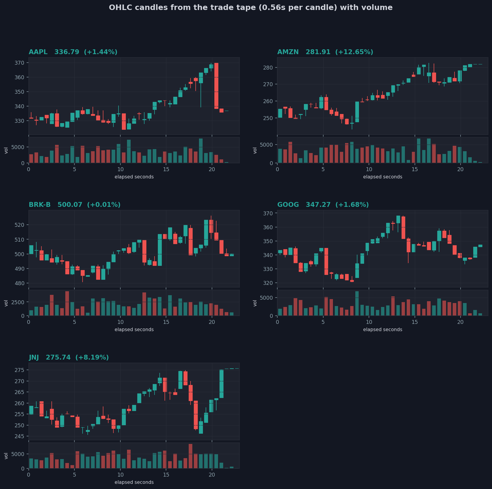
</p>

**Contents**: 
1. [The project](#the-project)
2. [Quick start](#quick-start)
3. [How to run it](#how-to-run-it)
4. [Two engines, two goals](#two-engines-two-goals)
5. [Reinforcement learning](#reinforcement-learning)
6. [No transaction costs](#no-transaction-costs)
7. [Data](#data)
8. [What the market report looks like](#what-the-market-report-looks-like)
9. [Highlights](#highlights)
10. [Repository layout](#repository-layout)


## 1. The project
| Folder | What it is | Details |
|---|---|---|
| [`Src_Simulation/`](Src_Simulation/README.md) | in-memory exchange, strategies, TCP server and client, trading days, market report, charts | [README](Src_Simulation/README.md) |
| [`Src_SQL/`](Src_SQL/README.md) | SQLite exchange with market phases and scripted clients | [README](Src_SQL/README.md) |
| [`Src_RL_Trading/`](Src_RL_Trading/README.md) | `Src_Simulation` plus the reinforcement learning layer: an agent trained walk-forward on recorded trading days of the simulated market, judged live against the rule-based bots, the `RL_Agents/` package, and how the Python agents and the C++ exchange talk | [README](Src_RL_Trading/README.md) |
| [`NRT/`](NRT/README.md) | 135 non-regression tests for `Src_Simulation` | [README](NRT/README.md) |
| [`NRT_RL_Trading/`](NRT_RL_Trading/README.md) | 150 non-regression tests for `Src_RL_Trading` (the exchange's, plus the trading days, the fundamental values, the policy client, the market feed and the RL bots against a fake policy server) | [README](NRT_RL_Trading/README.md) |
| [`Data/`](Data/README.md) | Yahoo Finance download, cleaning, features, database loading | [README](Data/README.md) |
| [`Test_Functionnalities/`](Test_Functionnalities/README.md) | the experiments behind the design: mutexes, sockets, password encryption, SQL in C++ | [README](Test_Functionnalities/README.md) |


## 2. Quick start
**The in-memory exchange and its bots** (only `make` and a C++20 compiler, plus Python with pandas and matplotlib for the charts):
```bash
cd Src_Simulation
./launch.sh                              # ~45 s: 36 bots in-process, then a server with 9 network bots
open output/latest/plots/index.html      # every chart and the market report of both phases
```
**The SQL exchange** (macOS with Homebrew: `brew install sqlite openssl@3 fmt sdl2 sdl2_ttf sdl2_image`):
```bash
cd Src_SQL && make
./server.x reset && ./server.x init && ./server.x play        # terminal 1
./client_account.x Client1 123                                # terminal 2, then: BUY 1 1 MARKET
./client_account.x Client2 123                                # terminal 3, then: SELL 1 1 MARKET
```
or with scripted clients on real prices: `cd Src_SQL/scripts && ./launch_multi_client.sh 20 6 30 --terminals --use_real_prices`

**Reinforcement learning agents trading in the exchange** (plus Python 3 with `pip install -r Src_RL_Trading/RL_Agents/requirements.txt`):
```bash
cd Src_RL_Trading
./launch.sh simu                         # ~4 min: 60 trading days of the calibrated market, the RL agents trading in it once trained
open output/latest/plots/index.html
```

**The tests**: `cd NRT && make test` (`Src_Simulation`), `cd NRT_RL_Trading && make test` and `cd Src_RL_Trading/RL_Agents && python3 -m rl_agents.selftest` (`Src_RL_Trading`)


## 3. How to run it
Every command below runs from the project root. Each part's README lists every option.

**Trade real tickers:** fetch prices first (needs network), the simulator then lists the real tickers at their last real price, with their real volatility:
```bash
Src_Simulation/scripts/refresh_data.sh small         # 10 large US stocks, 5 years of daily bars
Src_Simulation/scripts/refresh_data.sh full          # or the world indices of Data/tickers.txt
Src_Simulation/launch.sh                             # both phases, on those tickers
```

**Bigger, longer, or one phase only:**
```bash
Src_Simulation/launch.sh simu --simu-duration 300 --symbols 8 --noise 60 --marketmakers 12   # in-process only
Src_Simulation/launch.sh bots --bots 14 --bots-duration 120                                  # network session only
Src_RL_Trading/launch.sh simu --days 250 --rl-bots 4                                         # a trading year, 4 bots per RL agent
```

**Trade by hand against the bots** in two terminals:
```bash
cd Src_Simulation
./sim_server.x --port 7878                                        # terminal 1
./sim_client.x alice secret --register                            # terminal 2, then for example:
#   SYMBOLS
#   ORDER BUY AAPL 100 LIMIT PRICE=170
#   PORTFOLIO          (cash, what open orders reserve, holdings)
./sim_client.x bot1 pw --register --bot marketmaker --duration-sec 300   # add a bot whenever you like
```

**Several trading days** with a snapshot, stopping the server ends the day like a real exchange: a pre-close, a closing auction setting each symbol's official close, DAY orders expiring, and good-till-cancelled orders carried to the next day. The next start reloads accounts, positions, closing prices and open orders:
```bash
cd Src_Simulation
./sim_server.x --snapshot output/day.snapshot --closing-auction 5    # day 1: trade, then Ctrl-C
./sim_server.x --snapshot output/day.snapshot --closing-auction 5    # day 2 opens at day 1's closes
#   ORDER BUY AAPL 50 LIMIT PRICE=150 TIF=GTC     (kept from one day to the next until filled or cancelled)
scripts/launch_bots.sh --duration 60 --closing-auction 10            # a bots session whose last 10 s are the pre-close
```

**Train the RL agent in the simulator, from nothing** (about an hour, most of it simulated time):
```bash
cd Src_RL_Trading
scripts/simulate_market_days.sh            # 40 markets of 600 trading days (seeds 401..440), all at once, ~42 min
(cd RL_Agents && python3 -m rl_agents.train --data sim_days/real5_d600 --timesteps 300000 --seeds 2 --ent-coef 0.01 --jobs 8)   # ~12 min
scripts/evaluate_rl_live.sh                # the verdict, on 5 market seeds it never saw, ~5 min
```


## 4. Two engines, two goals
| | `Src_SQL` | `Src_Simulation` |
|---|---|---|
| state | SQLite database, every event stored | in memory, with an optional snapshot across restarts |
| market | pre-open, opening auction, continuous trading, pre-close, closing auction | continuous trading, then on stop a pre-close and closing auction, sessions chained day after day |
| orders | MARKET, LIMIT, STOP, LIMIT_STOP, validity date | the same, plus start dates, side-aware STOPs, a MARKET price collar, DAY and GTC time in force |
| accounts | AES-encrypted passwords | salted SHA-256 hashes, session tokens, balanced starting accounts, cash and share reservations |
| clients | interactive client, scripted clients | interactive client, 7 bot strategies in-process or over TCP, ML bots |
| protocol | raw TCP text | length-prefixed frames |
| output | before and after summaries, message log | logs, metrics, a 10-file market report, charts, HTML |
| speed | bounded by a database write for every event | about 300 orders per second with 36 bots, 7 &micro;s mean submit latency |


## 5. Reinforcement learning
**Agents that learn the trading decision by trial and error, in the simulated market they trade in**, judged the way a real strategy would be: walk-forward, a deployment gate, sealed markets, then live on markets they never saw. The simulated market is the only environment: real data only seeds the tickers and calibrates the market, it never trains an agent.

- **A real market architecture first**: `simulation.x` runs trading days, its only mode: 60 days in 4 minutes, each with a pre-open, an opening auction, continuous trading, a pre-close, a closing auction and a night. Each company has a fundamental value moving on its real volatility, with overnight news (the gap at the open), and value investors trade toward it. Calibrated against the real daily history of the same tickers: about +3 bp of drift a day (real: +4 to +7), 130 bp of daily volatility (108 to 229), almost no day-to-day autocorrelation (-0.03), real-like ranges and gaps, a 14 bp spread. Before calibration the simulated market rose 1% a day: the cause, noise traders whose sells were refused once a stock ran out while their buys kept drawing on shared cash, is fixed.
- **Many markets, long markets**: a market uses about 2.5% of a core whatever the number running at once (80 at once: 2 of 8 cores, the same wall time and the same spread, trade sizes and day clock as 12), so the agent's data is **40 markets of 600 trading days**, recorded together in about 42 minutes. `scripts/market_calibration.py` checks every recording against the reference market (volatility, range, gaps, spread within 15%) and that its book doesn't thin over the 600 days (the value per trade stays at about 73k).
- **The value investors are an informed benchmark, not a competitor**: they see each company's hidden fundamental value, the random walk that moves the prices, which no other bot and no agent sees. They trade on the news before it is in the price, and the excess over holding being zero-sum, their gain is the market makers' and the noise traders' loss (adverse selection). Every report shows them apart, never ranked with the strategies that only see prices ([details](Src_RL_Trading/README.md#3-the-value-investors-an-informed-benchmark-not-a-competitor)).
- **The RL agent**: once a day it chooses a direction, a stop-loss (in ATRs) and a take-profit (in multiples of the risk), from 23 scale-free daily features (none dropped) and its open trade. It follows a reference RL trading project's design (PPO on gold with bracket orders).
- **The reference project's validation protocol**: 12 sliding walk-forward folds (train 180 days, validation 30, test 30) across 32 simulated markets, trained in parallel processes with the same result as one at a time, checkpoints chosen on the weaker of train and validation with a drawdown penalty and a do-nothing guard, a deployment gate on the test windows, an ensemble of the last folds, 8 sealed markets evaluated once, baselines (always long, a tuned trend rule, random).
- **Live, inside the exchange**: `RLBot` sends its entries into the opening auction, then works a GTC stop-loss and take-profit (one cancels the other), every price it records is a real fill, and its trades are compared with what the training environment assumed (entries fill at the open, take-profits at their target, stop-losses a median 53 to 100 bp past the stop depending on the run, against the 100 bp the environment charges).
- **The bridge**: the C++ exchange streams each day's bars to the Python policy server and every RL bot asks it for decisions, over the exchange's own framed text protocol on a local socket ([details](Src_RL_Trading/README.md#7-how-python-and-c-talk)).

**What it found**: in a market this close to a real one, there was no edge the agent could hold fold after fold, and the gate refused it every time (0 to 3 consistent folds of 5 on 10 markets of 250 days, 2 of 12 on 40 markets of 600 days, where its closed trades lost a mean 0.04 to 0.30 R (the amount risked between the entry and stop-loss) in 10 folds of 12). The test windows' returns looked positive, but only because they mark the trades still open at the window's end in a rising market: the closed trades lost, and the gate, which needs both, wasn't fooled. On the 8 sealed markets its closed trades made a profit factor of 1.12, ahead of every baseline (always long 0.79): a first sign, not a consistent edge. What was built carefully is the protocol, free of data leakage, the model itself is a first attempt: no feature engineering beyond the reference project's 23 daily features, no hyperparameter tuning beyond its preset, one small simulated market and never real data. The verdict is about this agent, not about what a stronger model could find ([limitations](Src_RL_Trading/README.md#12-known-limitations)). One full run costs about an hour on an 8-core laptop, what exploring further would cost, from more markets to a hyperparameter search, is in [section 13](Src_RL_Trading/README.md#13-what-it-costs-and-what-could-be-explored). Live, the last fold's model ends above holding on 5 markets of 5 (+18k to +21k on 10 million), third among the strategies that only see prices, behind the always-long baseline (+44k, on markets that happened to rise) and TWAP, a first live run of the same agents on the same seeds placed it second, the noise of a live verdict. The largest lesson was execution: the first live runs lost on every market until live trading matched what the agent trained on. That meant entries in the auction (a market order just after it paid a mean 141 bp over the open), a size the thin simulated book can absorb, and stop-losses priced at their measured live cost (the cascade of stops an overnight gap releases at the open) ([details](Src_RL_Trading/README.md#6-live-inside-the-exchange)).

| | |
|---|---|
| **The market**: every daily statistic of the 40 simulated markets against the 5 real tickers, the real range shaded | **The training**: each fold's train-eval and validation scores per checkpoint, the kept one starred |
| 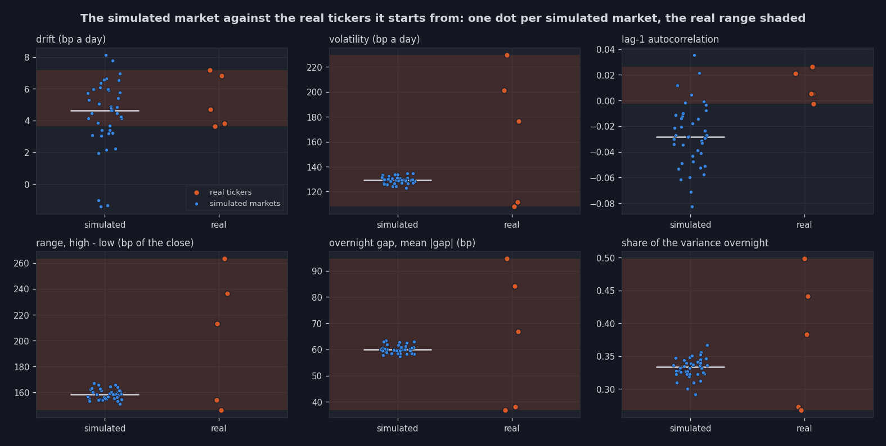 | 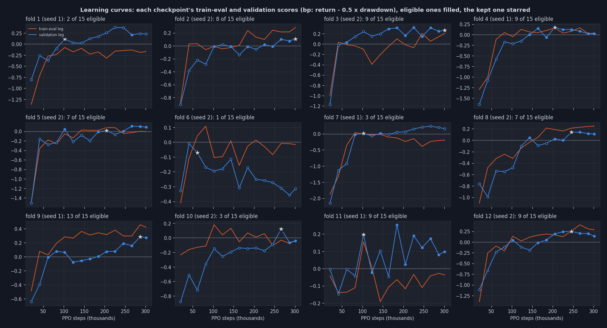 |
| **Is PPO converging?** Entropy, approximate KL and explained variance of every training | **The test windows**: the agent's Sharpe against the baselines, and its profit factor against the gate (2 folds of 12 pass) |
| 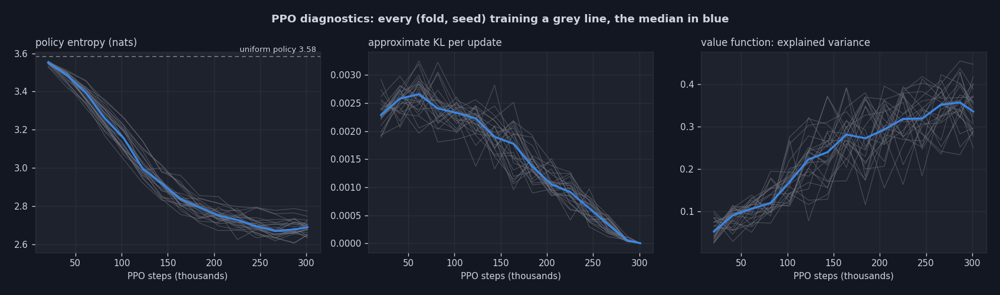 | 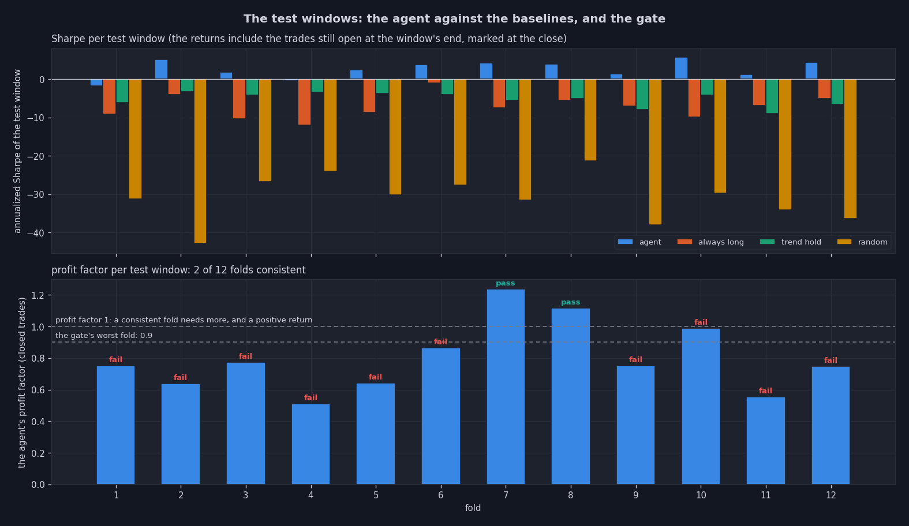 |
| **Out of sample**: every test window joined, the agent against always long, trend-hold and flat | **What the agent does**: it never shorts, and most of its trades end with a close at the open |
| 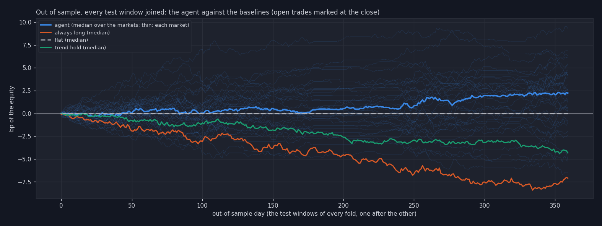 | 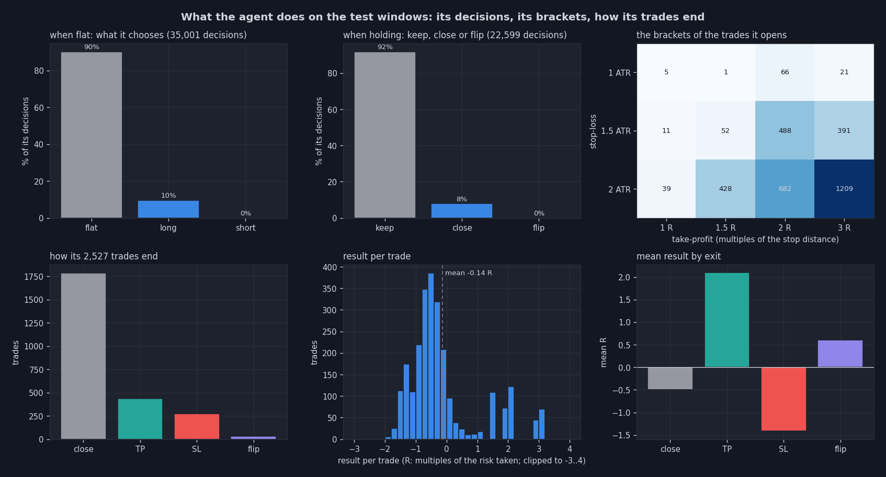 |
| **Live, on 5 unseen markets**: what each strategy added over holding, the value investors apart, the RL agents on their own scale | **One live market's report**: the same measure, every dot one bot |
| 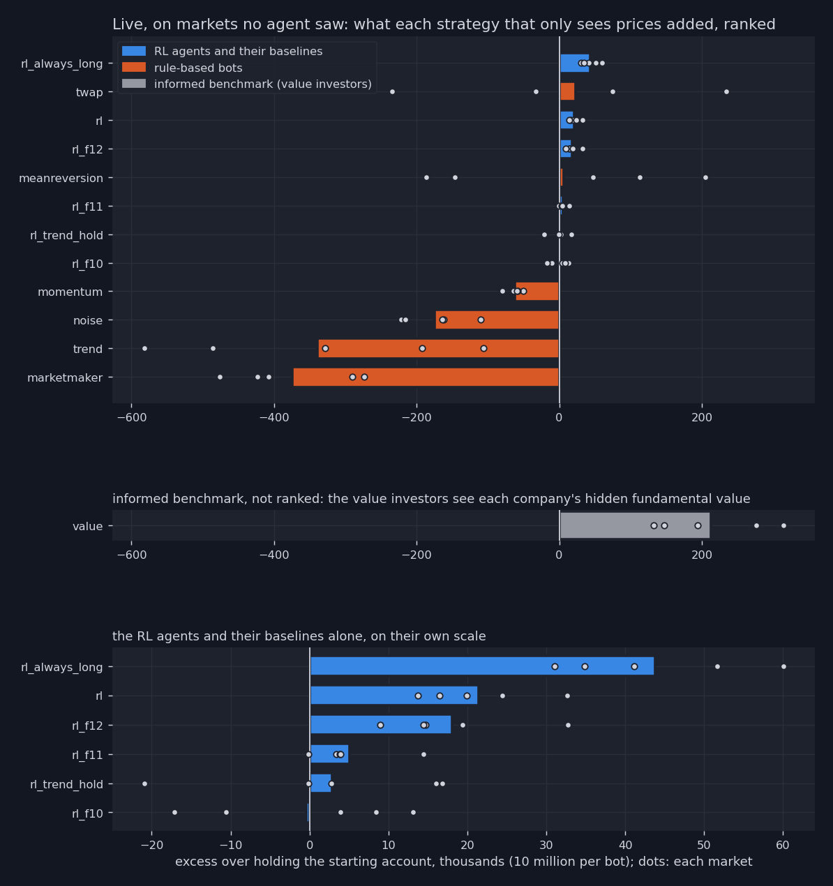 | 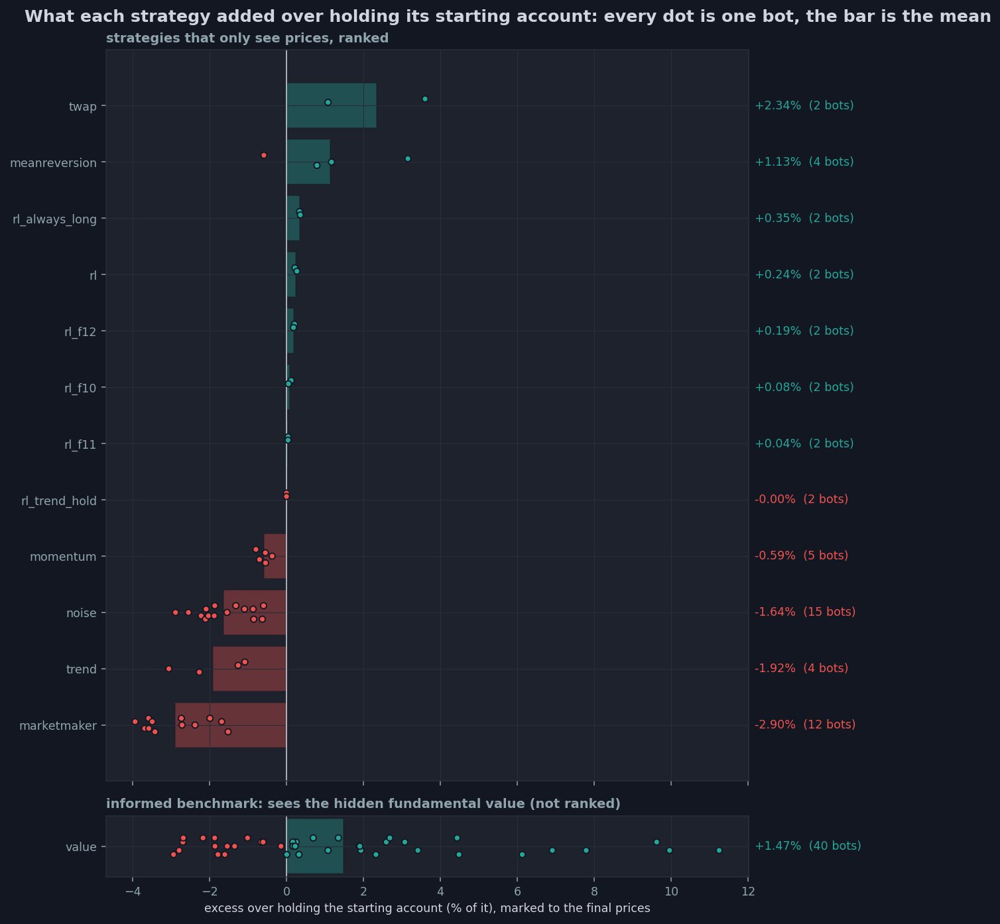 |

The charts follow the pipeline, from the market to the live verdict, and every stage draws its own automatically at the end of its run (calibration, training, live evaluation, `scripts/plot_rl_report.py` builds the verdict as one page that links the others). The strategy charts show the **excess over holding**, not the raw P&L: every bot starts half in stock, so its raw P&L is mostly the market's own move (about +3% for every strategy on these rising markets, even those that lost value by trading), while the excess keeps only what the strategy added, and sums to zero over all the bots of a market.


## 6. No transaction costs
The simulator charges **no fee and no commission**: a bot can change its position at every tick for free, so strategies that trade a lot are not penalized as they would be with a real broker. The costs that do exist are the bid-ask spread a MARKET order crosses (about 7 bp against the mid in the calibrated trading-day market, 21 bp in the continuous one), the slippage and the depth of the book, and the RL agents pay them: in their training reward, their backtests and live. Fees appear only in the research notebooks, as a check of whether an edge would survive a real broker: most RL seeds on real data don't (Sharpe 1.54 down to 0.10 at 5 basis points per trade).


## 7. Data
`Data/` downloads daily prices from Yahoo Finance (world indices from `Data/tickers.txt`, or large US stocks), cleans and merges them, computes returns, moving averages, volatility and RSI, and loads them into the SQL exchange's database. `Src_Simulation` reads the latest prices and volatility directly from the processed files, so its bots trade real tickers from their real last price and with their real volatility. The RL agents train on the full history (see [Data/README.md](Data/README.md)).


## 8. What the market report looks like
| | |
|---|---|
| **Portfolios**: every bot's net worth during the simulation, and the P&L distribution | **Strategies**: the P&L of every bot strategy, one dot per bot (`Src_Simulation`'s raw P&L, `Src_RL_Trading`'s chart shows the excess over holding instead, see [Reinforcement learning](#reinforcement-learning)) |
| 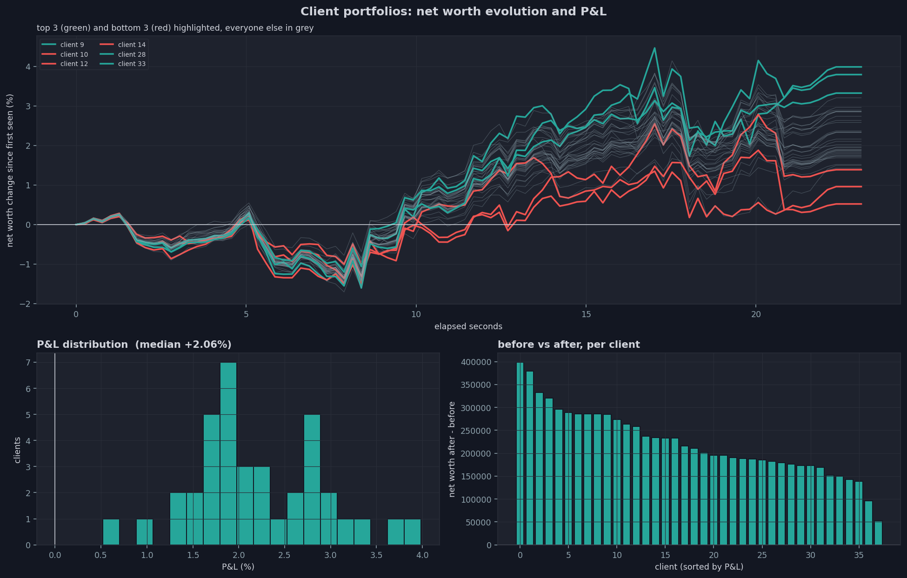 | 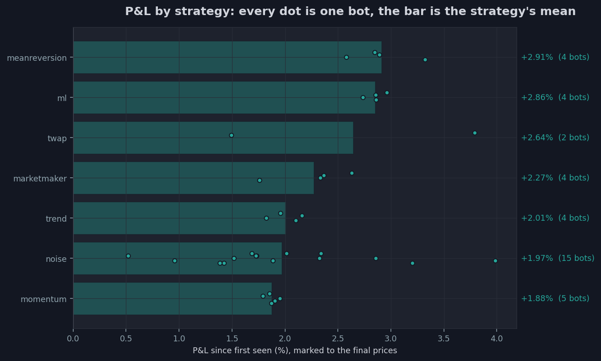 |
| **Depth**: the order book at the end of the simulation, with the last price and the best bid and ask | **Waiting orders**: every waiting STOP order's trigger band against the final price |
| 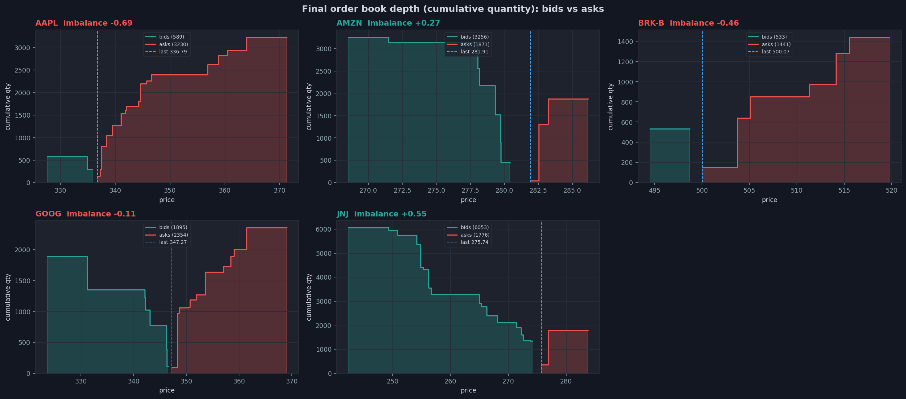 | 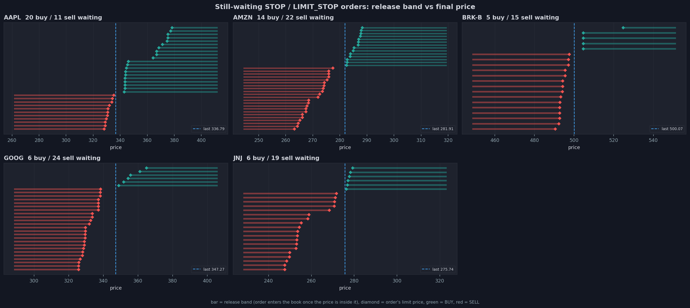 |
| **Order book pressure**: the imbalance between buy and sell orders over time | **Trade flow**: volume, notional and trade sizes per symbol |
| 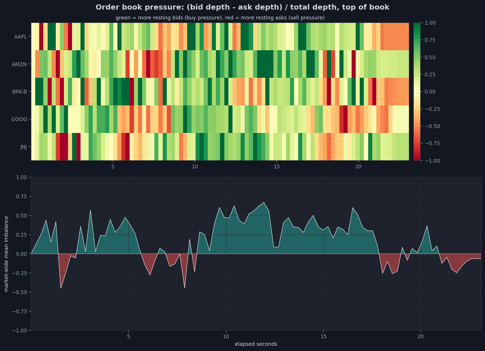 | 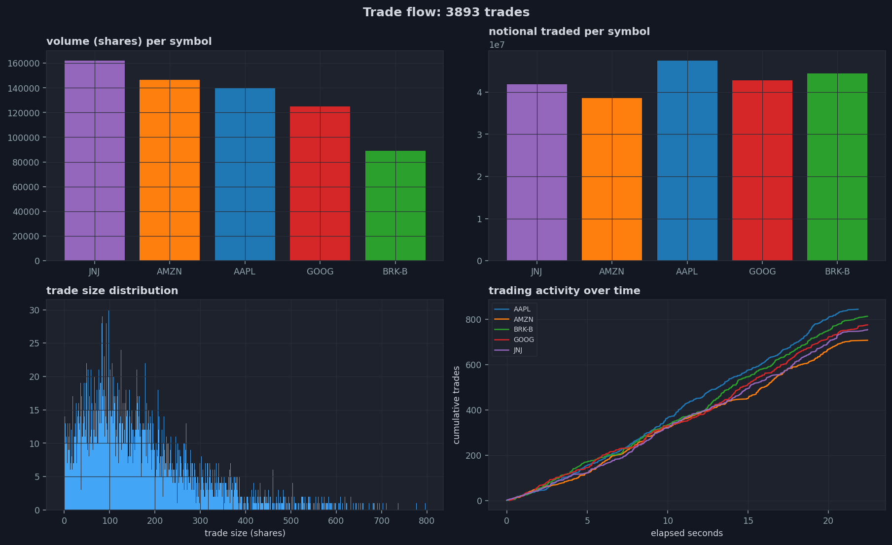 |


## 9. Highlights
- **Correctness first**: open orders reserve cash and shares, so an account can never be over-committed, the report checks on every run that cash is conserved and nobody ends overdrawn
- **A fair market**: every account starts balanced by value (half cash, half stock split equally across symbols) and orders are sized by value, so index-priced symbols no longer make every bot a seller
- **One strategy, two transports**: every bot is written once against a `MarketGateway` and runs unchanged in-process or as a real network client
- **Trading days**: time in force (DAY, good till cancelled, good till date), a closing auction setting the official close, and a snapshot carrying accounts, closes and open orders to the next session, which opens with an auction
- **Honest reinforcement learning**: agents trained in the C++ simulation, scored only on periods and markets they never saw, compared with simple baselines, judged across folds and seeds rather than by their best run, and refused by a deployment gate when their edge doesn't hold
- **Bugs found by measuring, and pinned by tests**: over-committed accounts, cancelling other clients' orders, a server killed by one client disconnecting, BUY stops that pushed every price up, a market maker that doubled volatility, trading that continued after the close, each has its regression test, see [NRT/README.md](NRT/README.md)


## 10. Repository layout
```text
Stock_Market_Trading_Simulator/
├── Data/
│   fetch_data.py preprocess.py feature_engineering.py enter_in_database.py tickers.txt
│   README_Pictures/ (the charts of this README)
│
├── NRT/
│   test_*.cpp nrt_framework.hpp Makefile output/ (files written by the tests)
│
├── NRT_RL_Trading/
│   the same, for Src_RL_Trading, plus test_rl_bots.cpp (the C++ half of the Python bridge)
│
├── Src_Simulation/
│   ├── include/
│   ├── src/
│   ├── scripts/
│   ├── launch.sh
│   ├── models/        (the ML bots' model)
│   └── output/        (one folder per run)
│
├── Src_RL_Trading/
│   ├── include/ src/ launch.sh   (Src_Simulation's, plus trading days only, fundamental values, RLBot, the policy client, the market feed, --days, --rl-*)
│   ├── scripts/       (launchers, simulate_market_days.sh, evaluate_rl_live.sh, policy_server.sh)
│   ├── RL_Agents/
│   │   ├── rl_agents/     (daily, env, ppo, train, policy, serve, protocol, selftest)
│   │   ├── sim_days/      (the recorded trading-day markets, rebuilt by simulate_market_days.sh)
│   │   ├── reports/       (the training's logs and reports, rebuilt by train)
│   │   └── artifacts/     (trained agents once trained: rl, its fold models rl_f<k>, the two rule baselines)
│   └── output/        (one folder per run)
│
├── Src_SQL/
│   *.cpp *.hpp makefile scripts/ (launcher, order generator, logs)
│
└── Test_Functionnalities/
    ├── Mutex/
    ├── Sockets/
    ├── Password_Cryptage/
    └── SQL_in_cpp/
```
