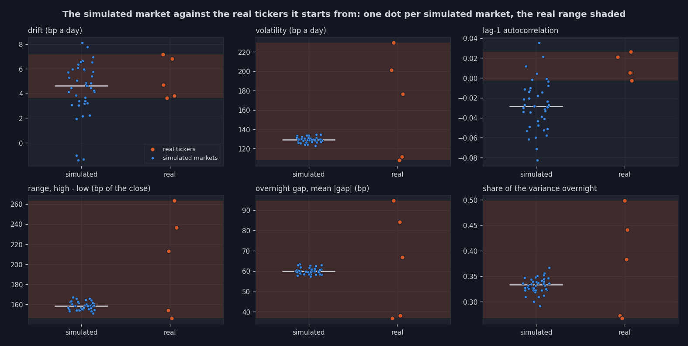
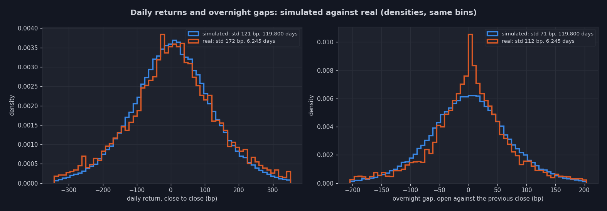
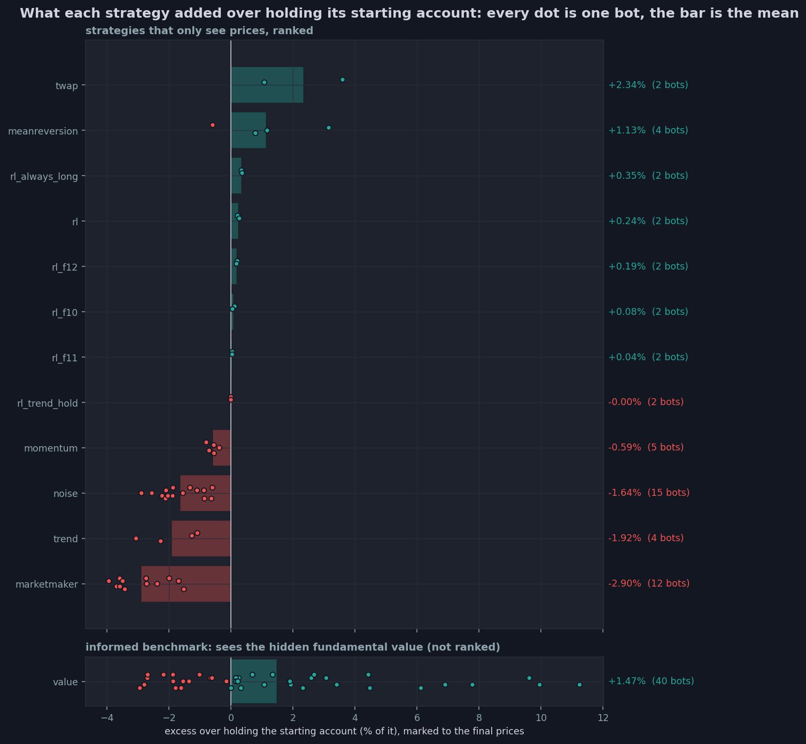
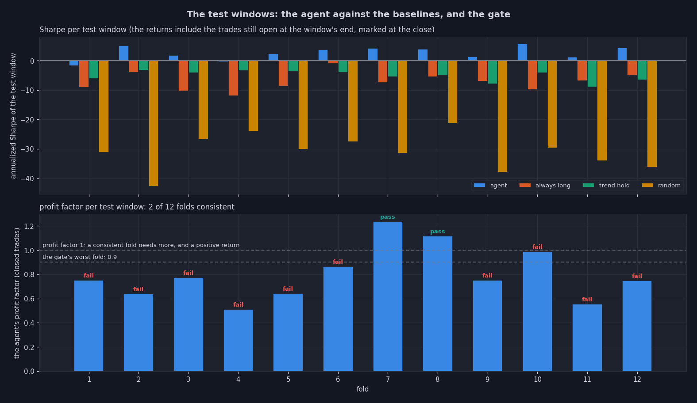
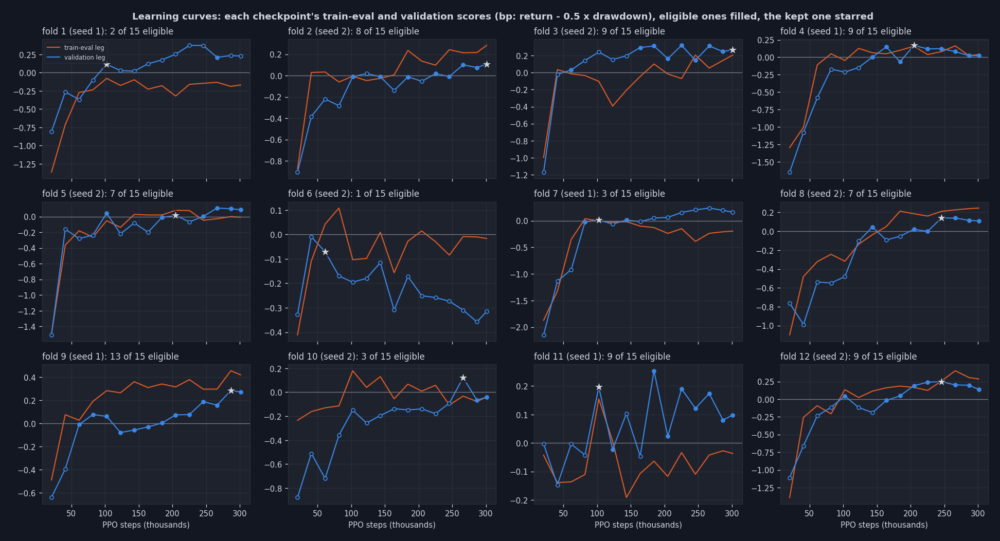
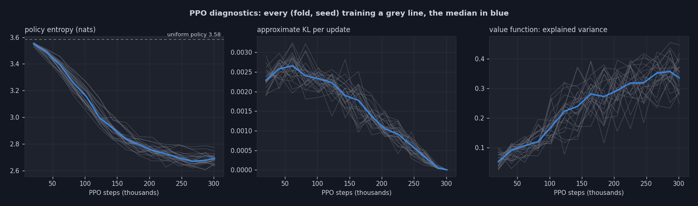
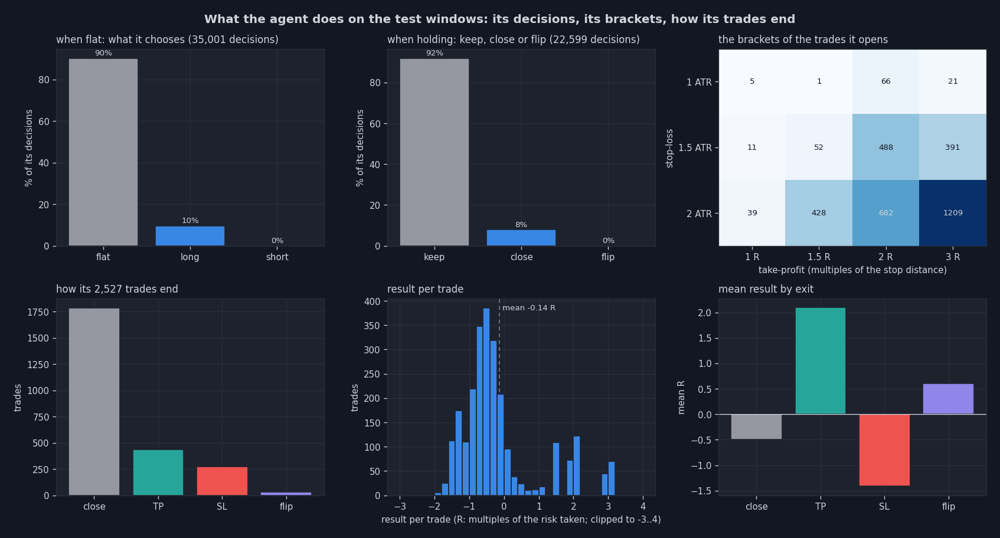
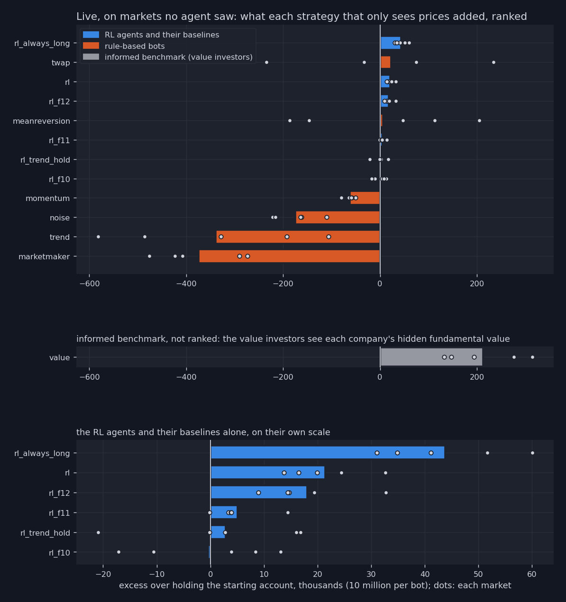
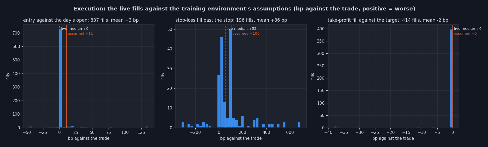

# Src_RL_Trading: reinforcement learning agents trained in a C++ stock exchange
`Src_Simulation`'s exchange (matching engine, rule-based bots, TCP server, market report), turned into a **market with trading days calibrated on real stocks**, plus reinforcement learning agents that **learn to trade inside it** and then trade in it as bots:

- **a real market architecture**: `simulation.x --days 60` is 60 trading days in 4 minutes, each with a pre-open, an opening auction, continuous trading, a pre-close, a closing auction and a night, each company has a fundamental value moving on its real volatility, with overnight news, and value investors trade toward it. Its daily closes move like the 5 real tickers it starts from (section 2)
- **the RL agent** (`rl`): **the PPO**: once a day it chooses a direction, a stop-loss and a take-profit (a bracket), traded live with real STOP and LIMIT orders (sections 4 to 6) (walk-forward validation, the gate, and the verdict offline, then live inside the exchange)
- **the bridge**: the C++ simulator streams each day's bars to a Python policy server, every RL bot asks it for its trades over the exchange's own framed text protocol (section 7)

The simulated market is the only environment: real data only seeds the tickers and calibrates the market, it never trains an agent.

The exchange itself (order kinds, reservations, the protocol, sessions, the market report) is documented in [Src_Simulation/README.md](../Src_Simulation/README.md).

**Result** (sections 5 and 6): in a market this close to a real one there was little to earn, and the protocol says so. The walk-forward gate refused every version of the agent, the last one on 40 markets of 600 days: 2 consistent folds of 12, its closed trades losing a mean 0.04 to 0.30 R in 10 folds of 12. Live, three of the four agents end above holding their starting account, the last fold's model on 5 market seeds of 5: among the strategies that only see prices, only an always-long bracket and TWAP did better. The value investors, who see each company's hidden value, are an informed benchmark shown apart (section 3), not a competitor. The work that mattered most was making live execution match what the agent trained on: orders at the open's auction, stop-losses priced at their measured live cost, a size the thin simulated book can absorb.

**Contents**:
1. [Quick start](#1-quick-start)
2. [A real market architecture: trading days](#2-a-real-market-architecture-trading-days)
3. [The value investors: an informed benchmark, not a competitor](#3-the-value-investors-an-informed-benchmark-not-a-competitor) ·
4. [The RL agent](#4-the-rl-agent)
5. [Walk-forward validation, the gate, and the verdict offline](#5-walk-forward-validation-the-gate-and-the-verdict-offline) ·
6. [Live, inside the exchange](#6-live-inside-the-exchange)
7. [How Python and C++ talk](#7-how-python-and-c-talk) ·
8. [Several markets](#8-several-markets)
9. [Programs and scripts](#9-programs-and-scripts) ·
10. [Layout](#10-layout)
11. [Testing](#11-testing) ·
12. [Known limitations](#12-known-limitations)

## 1. Quick start
The trained agents of run 4 (section 5) are in `RL_Agents/artifacts/` (`rl`, `rl_f1`..`rl_f12`, `rl_always_long`, `rl_trend_hold`). They failed their gate, and the launchers say so when they serve them. Without any agent, the launchers run the rule-based bots only.

**Watch a trading-day market** (240 s: 60 trading days of 4 s, the calibrated market of section 2):
```bash
cd Src_RL_Trading
./launch.sh simu                           # builds, runs 60 trading days, plots, serves the RL agents when trained (with a notice when they failed their gate)
open output/latest/plots/index.html        # the market report, daily_bars_simu.csv holds one bar per symbol per day
```

**Record the market, train the RL agent, judge it live** (from `Src_RL_Trading/`, about 75 minutes):
```bash
scripts/simulate_market_days.sh            # 40 markets of 600 trading days (seeds 401..440), all at once, ~42 min
(cd RL_Agents && python3 -m rl_agents.train --data sim_days/real5_d600 --timesteps 300000 --seeds 2 --ent-coef 0.01 --jobs 8)
scripts/evaluate_rl_live.sh                # 5 unseen markets of 60 days (seeds 42..46) inside simulation.x, ~5 min
```
**Common variations:**
```bash
./launch.sh simu --days 250 --symbols 8                                         # a trading year, 8 symbols
./launch.sh simu --rl-models "rl_f4 rl_always_long"                            # chosen agents (served even if ungated: name them)
./launch.sh --help                                                              # every option
```


## 2. A real market architecture: trading days
`simulation.x` runs **trading days**, its only mode (`--days N`, 60 by default), each with the phases of a real exchange (`include/market_session.hpp`). 60 days of 4 seconds: 240 s of simulation are 60 trading days:

<pre style="white-space: pre; overflow-x: auto;">
 one trading day (--day-ms 4000)                                                                 the night (--overnight-ms 100)
┌───────────────┬───────────────────────────────────────────────────────────┬───────────────┬──────────────────────────────────┐
│ PRE_OPEN 10%  │ OPEN: continuous trading                                  │ PRE_CLOSE 10% │ CLOSED                           │
│ orders rest,  │ the bots trade, STOP orders trigger, the RL bots'         │ orders rest,  │ closing auction (the official    │
│ nothing       │ legs work (their entries came in the pre-open)            │ nothing       │ close), every DAY order expires, │
│ matches       │                                                           │ matches       │ the day's bar goes to the policy │
│      opening auction: the open                                            │               │ server, bots asleep, overnight   │
│      (unfilled MARKET orders expire)                                      │               │ news moves the values            │
└───────────────┴───────────────────────────────────────────────────────────┴───────────────┴──────────────────────────────────┘
</pre>

- **GTC orders carry from day to day** (the RL bots' stop-losses and take-profits): they meet the next day's orders in the opening auction, and their clock only counts trading time (`MatchingEngine::open_market` moves every dated order back by the time the market stayed closed).
- **MARKET orders in an auction** join at a ±2% auction collar around the reference price (market-on-open / market-on-close) and expire if the auction doesn't execute them: a market order is immediate or cancel, it never rests into continuous trading.
- **Every day writes one bar per symbol** (`daily_bars_simu.csv`): open (the opening auction), high, low, close (the closing auction), volume, VWAP, number of trades, the book when the pre-close started (best bid and ask, top-10 depth), and the overnight gap. The report adds a `-- Trading days --` block: per symbol, the daily drift, volatility, lag-1 autocorrelation, range and gaps.

### Calibrated on the real tickers
The first version of trading days kept the continuous market's bots and only added the clock. Measured on 60-day runs against the real daily history of the same 5 tickers (`Data/`, 1250 days each), it was nothing like a stock market:

| per day, median over symbols | the uncalibrated market (Src_Simulation's bots), cut into days | **calibrated**: the agent's 12 markets x 250 days | the real tickers |
|---|---|---|---|
| drift | +100 bp | **+3.0 bp** | +3.6 to +7.2 bp |
| volatility | 526 bp | **130 bp** | 108 to 229 bp |
| lag-1 autocorrelation | -0.34 | **-0.04** | -0.003 to +0.026 |
| range (high - low) | 690 bp | **164 bp** | 146 to 263 bp |
| mean absolute overnight gap | 84 bp | **70 bp** | 37 to 95 bp |
| share of the variance overnight | 0.13 | **0.50** | 0.27 to 0.50 |
| spread before the close | 65 bp | **14 bp** | 1 to 5 bp |

Over a simulated year, each stock ends between -33% and +68%: some rise, some fall, the market no longer only goes up.

What changed, each measured on its own before keeping it:
1. **A fundamental value per company** (`include/fundamentals.hpp`): a random walk on the ticker's **real** volatility (its 20-day annualized volatility from `Data/`, / sqrt(252) per day), with 35% of its variance arriving **overnight** as news: at each open the value jumps, the reference price with it, and the day opens with a gap. +5 bp a day of drift, the real tickers' mean.
2. **40 value investors** (`ValueInvestorBot`, `--value`, section 3): each sees the value with its own persistent estimation error (investors disagree by about a third of a day's move), buys below it and sells above it, patiently (a limit a third of the way toward the value) when the gap is small, at market when it is large. They anchor the price: without them, the price was whatever the order flow made it.
3. **The drift's cause, removed**: every bot holds half its account in cash (one pool for all symbols) and a tenth in each stock, and the noise traders flipped a fair coin. Once a symbol's shares ran out its sells were refused while its buys kept drawing on the shared cash: a structural buying pressure of about +1% a day. Noise traders now lean toward their starting mix (`NoiseTraderBot::buy_probability`): one that sold down a symbol buys it more often.
4. **A pre-open and an opening auction**: at first, continuous trading started on a book emptied by the close (every DAY quote expired), and the first market orders swept it to the 10% collar, through the stop-losses and the take-profits at once (the first live RL trades showed it: stops filled 2% through, targets 5% away hit in the same minute). The pre-open fills the book (the market makers quote, the GTC orders wait) and the auction sets one opening price.
5. **The auction collar**: with the continuous 10% collar, a few market orders in a thin pre-open set opening prices 1 to 2% away from the close, at ±2% the gaps look like real ones. (A market buy reserves cash at the 10% collar: the difference is released when it joins an auction at 2%, a leak the NRT now pins.)
6. **Tighter, more numerous market makers**: 12 makers quoting mid ±0.1% (`--maker-half-spread`) instead of 8 at ±0.5%. The spread went from 45 to 14 bp, and the day-to-day autocorrelation from -0.13 to -0.04: with wide quotes the closes overshot and came back the next day. It mattered for the agent too (section 5): the wide-spread market had a real day-to-day reversal (+22 bp after the worst fifth of days, -23 after the best), but entering and leaving at market cost about 55 bp, more than it paid.

What stays off: the spread is 3 to 10 times a large real stock's, and the book is thin (about 8 million traded per symbol per day, 165 shares a trade), which sets how large an agent's trades can be (section 6). The continuous market without trading days lives on in [Src_Simulation](../Src_Simulation/README.md). `Src_RL_Trading` has trading days only.

### The calibration charts
`python -m rl_agents.calibration` draws them after every recording (section 9), here for `real5_d600` against the real daily history of its 5 tickers. Each daily statistic, every simulated market a blue dot and each real ticker an orange one, the real range shaded:

<p align="center"></p>

The drift, the range, the gaps and their share of the variance fall inside the real range, the volatility (about 129 bp a day) sits at its low end (108 to 229), and the lag-1 autocorrelation (-0.03) just below every real ticker's (the value investors' pull back toward the value). The distributions show the one clear difference:

<p align="center"></p>

The daily returns match in shape, the real overnight gaps are much more peaked around zero than the simulated ones, which are Gaussian: most real nights bring little news and a few bring a lot, while the simulated news is the same normal draw every night.

### Scale: more markets, longer markets, the same day
A trading day stays 4 s (`--day-ms 4000`): shorter days thin the book, since the bots act every 20 to 200 ms (at 1 s days the RL bot already missed 8 pre-opens of 30). The market grows in the two other directions, measured on an 8-core M1 (8 GB) before recording:

| markets at once (5-day runs) | CPU per market | all of them | memory per run | wall time |
|---|---|---|---|---|
| 1 | 3.0% of a core | 0.03 cores | 6 MB | 27.1 s |
| 40 | 2.6% | 1.0 core | 6 MB | 26.7 s |
| 60 | 2.3% | 1.4 cores | 6 MB | 26.6 s |
| 80 | 2.4% | 2.0 cores | 6 MB | 26.7 s |

Each run is 87 threads that mostly sleep. **The market doesn't change with the load**: on the same seeds (501..512, 30-day markets) run 12, 40 and 60 at a time, the spread was 14.0 / 13.5 / 13.9 bp, the trades per symbol per day 171 / 172 / 173, the shares per trade 214 / 216 / 216, the value traded 12.3 / 12.2 / 12.3 million, the range 168 / 169 / 169 bp, the day clock 4112 / 4112 / 4111 ms (day + night): drift, volatility and autocorrelation moved within their sampling noise (a symbol's 30-day drift has a standard error of about 22 bp). **A seed is not a replay**: the same seed draws the same news, but the threads' timing changes the order flow, so two runs of one seed are two markets. **Long runs cost memory and thin slightly**: the recorder keeps the run's trades and samples until its end (about 60 to 70 MB for 600 days at `--report-interval-ms 1000`, the portfolio samples, which training never reads, were two thirds of the files at 250 ms), and in the 250-day markets the last third of the days had 9% fewer trades, 6% smaller ones, 8% less value traded than the first (spread, volatility and gaps unchanged). `scripts/market_calibration.py` checks both on every recording: the statistics against the reference market within 15%, and the book's size from the first third of the days to the last.

So `scripts/simulate_market_days.sh` records **40 markets of 600 trading days**, all at once (about 42 minutes, one core): `RL_Agents/sim_days/real5_d600`, seeds 401..440.


## 3. The value investors: an informed benchmark, not a competitor
Every report of this project puts the value investors (`value`, 40 bots, `simulation.x --value 40`) **apart from the strategies**: the strategies, the RL agents among them, only see prices while the value investors see the variable that moves the prices. Ranking them together would only say that information pays, which is how the market was built.

### What they see
Each company has a **fundamental value** (`include/fundamentals.hpp`), a random walk on its log price calibrated on the ticker's real volatility: at each open one shock carries 35% of the day's variance (the night's news, which also gaps the price the day opens from), the other 65% diffuses in small steps during the day, plus a drift of +5 bp a day. **No other bot sees it, and neither does the RL agent**: they see the book and the trades, the agent the daily bars. `ValueInvestorBot` (`src/bot.cpp`) reads it at every tick, with its own persistent estimation error (a standard deviation of 0.3 of a day's move, drawn once per symbol, so the 40 investors disagree), and:
- does nothing when the price is within a quarter of a day's move of its estimate
- otherwise places a patient limit a third of the way toward its estimate (retracted after a few ticks), sized on the gap
- beyond 1.5 days' move, crosses at market

### The value is the random walk, the price follows it
Nothing in the matching engine knows the value: the price tracks it only because the value investors buy below it and sell above it, while the noise, momentum and trend bots push it away. So the price is the random walk plus a deviation that keeps closing. Measured on the 200 price paths of `real5_d600` (40 markets x 5 symbols x 600 days):

| horizon k | variance ratio: var(k-day return) / (k x var(1-day return)) |
|---|---|
| 1 day | 1.00 |
| 5 days | 0.93 |
| 20 days | 0.88 |
| 60 days | 0.82 (about 0.9 once corrected for the 10 returns a 600-day path gives at this horizon) |

A random walk gives 1 at every horizon. Day to day the price is one (lag-1 autocorrelation -0.025), over weeks it reverts slightly toward the value, the gap the value investors close.

### Why they win, and who pays
When the value moves during the day, the price hasn't moved yet: the value investors trade on the news before it is in the price, and their own trading is what moves it. The excess over holding is **zero-sum** (every trade moves money from one account to another, over all the bots of a market it adds up to exactly 0, checked on the 5 live markets), so their gain is the others' loss. Per market, the 5 markets of run 4's first live run (section 6) on average:

| | bots | excess over holding, all its bots together |
|---|---|---|
| **value (informed benchmark)** | 40 | **+8.7 million** |
| market makers | 12 | -5.3 million |
| noise traders | 15 | -2.6 million |
| trend followers | 4 | -0.7 million |
| momentum | 5 | -0.3 million |
| every other strategy, the RL agents included | | between -0.01 and +0.1 million each |

- **The market makers pay most (adverse selection)**: they quote around the mid, about 2,500 trades each per market, when the value moves their quotes are stale, and the value investors take exactly those, on the side about to move against the maker.
- **The noise and trend bots pay the rest**: they push the price away from the value, the value investors take the other side.
- **Not every value investor wins**: on the 200 of the 5 live markets the median excess is +1.35% of the account (mean +2.17%, best +16.9%, worst -6.5%) and **74 end below holding**, those whose estimation error is large and on the wrong side. Their errors cancel across the 40, so the group wins. Over the 600-day recorded markets (no RL bot) they average +1.2 million each.

### How the reports show them
| report | the strategies that only see prices | the value investors |
|---|---|---|
| `simulation.x` (the end-of-run text) | `-- Strategies (they only see prices, ranked by mean_excess_vs_holding) --` | `-- Informed benchmark (sees the hidden fundamental value, not ranked with the strategies) --` |
| `plot_market_report.py` (`10_strategies`, the HTML tables) | ranked by excess over holding | their own panel and table, not ranked |
| `plot_market_report.py` (`06_order_lifecycle`) | their rejections in red, by reason | their rejections stacked in grey, and by reason on their own scale |
| `plot_market_report.py` (`07_portfolios`) | the top 3 (green) and bottom 3 (red) by P&L are picked among them | always in the grey background, never highlighted |
| `plot_rl_report.py` (the RL verdict page) and `evaluate_rl_live.sh` | ranked (rank column), RL agents in blue, rule-based bots in orange | apart, in gray, not ranked |

**Most rejected orders are theirs:** Each value investor keeps its opinion of a stock, so where it thinks a stock is overpriced it sells it out, then keeps trying: after 10 trading days 77 of the 200 (investor, stock) pairs are sold out, and on the 5 live markets the value investors account for about 38,000 rejections per market (35,500 for shares they no longer hold), against about 4,800 for every strategy together (4,600 of them the 4 trend followers'). A refused order never reaches the book, so the market is unchanged, the rejection counts are not a fault of the exchange. `rejections_by_client_simu.csv` (written by the recorder) is what lets chart 06 tell them apart.

The market report's strategy chart now shows the **excess over holding** instead of the raw P&L: every bot starts half in stock, so its raw P&L was mostly the market's own rise (every strategy near +3% on a rising market), and the differences between strategies were invisible.

<p align="center"></p>

**What it means for the RL agent**: the value investors are an upper bound, what knowing the value is worth, not a strategy to beat from prices alone. The agent is judged against what sees the same thing it does: holding its account (excess 0), the always-long and trend-hold baselines run with its own orders, and the rule-based strategies.


## 4. The RL agent

### What it sees, what it does (`rl_agents/daily.py`, `rl_agents/env.py`)
| | |
|---|---|
| **time step** | one trading day of one symbol of one recorded market: the agent decides after the close, its orders reach the market at the next open (exactly what the live bot does) |
| **market features** (23, all kept) | scale-free, every distance in ATRs (the 14-day average true range): the close against its 5, 10 and 20-day EMAs, the 5/20 EMA spread, a MACD histogram, the 10-day rate of change, volatility (ATR / close, fast / slow ATR, Bollinger width), the day's candle (range, both wicks, body), the last 1 to 5 days' returns, the **overnight gap**, volume and trade-count surprises, the **spread** and the **depth imbalance** of the book before the close. 20 days of warm-up |
| **position features** (6) | direction, unrealized result in R (multiples of the risk taken), days held, distance to the target and to the stop in ATRs, the trade's planned reward-to-risk |
| **action** | MultiDiscrete: direction (flat or close / long / short) x stop-loss (1, 1.5, 2 ATR) x take-profit (1, 1.5, 2, 3 times the stop distance): 36 brackets |
| **execution** | entry, close or flip at the next open (the live bot's orders join the opening auction), paying half the spread at the previous close plus 5 bp, size: 0.2% of the equity at risk on the stop distance, capped at 0.5% of the equity (50k for a 10-million account, about one typical trade of the simulated book). Then the day's **recorded trades are walked in order**: the first one through the stop fills the stop-loss at *that* price (a gap through the stop fills worse than the stop) minus **100 bp, the stop's cost measured live** (section 6), the first one through the target fills the take-profit. Both are GTC: they carry to the next days |
| **reward** | the day's equity change divided by the risk budget (R units, which keeps PPO's scale stable), + 0.01 x the open trade's unrealized R, - a small holding penalty |
| **episode** | 40 days of one symbol of one market, a random start, inside the fold's training window |

**Feature audit, not selection:** nothing is dropped, during tuning or otherwise: `feature_audit` only reports such pairs (there are none on the recorded markets). **Leakage check**: `leakage_check` recomputes every feature with future days appended and requires the past to stay identical to the last bit. It caught a real look-ahead on its first run (a missing spread filled with the median of the *whole* series: it now carries the last known one forward).

### PPO (`rl_agents/ppo.py`)
- two MLPs (128, 64, tanh), a policy and a value function, orthogonal initialization
- a **factorized policy**: one softmax head per action component, the action's log-probability the sum of the three
- rollouts of 2048 steps, advantages by **GAE** (lambda 0.95, gamma 0.95: a trade lasts days), normalized per minibatch of 256
- the **clipped surrogate** (0.1), an entropy bonus (0.01 here left the policy close to random), a squared-error value loss, 5 epochs per rollout, stopped early when the approximate KL passes 1.5 x 0.025
- Adam with weight decay (1e-5), the learning rate decaying linearly, gradients clipped to a norm of 0.5
- observations normalized by a running mean and variance and rewards by the running std of the return (what `VecNormalize` does): the normalization is **saved with every checkpoint**, so a model is always used with the statistics it was selected with

Every gradient is checked against finite differences in the self-test (largest error about 1e-11), and a small agent must learn to go long in a rising synthetic market.


## 5. Walk-forward validation, the gate, and the verdict offline
`python -m rl_agents.train --data sim_days/real5_d600` runs on the 40 recorded markets (`scripts/simulate_market_days.sh`: seeds 401..440, 600 trading days each, ~143 trades per symbol per day). Runs 1 to 3 below used the earlier `real5` market (12 markets of 250 days, seeds 301..312, since removed: `real5_d600` replaces it) with 90/20/20/20-day folds and 2 sealed markets.

1. **Sealed markets**: the last 8 seeds (433..440) are never seen by any training, checkpoint or tuning choice. They are evaluated once, at the end.
2. **Sliding walk-forward on the day index**, the same calendar for the 32 development markets: train on 180 days, pick the checkpoint on the next 30, judge on the 30 after, slide by 30, with 2 days of embargo at each boundary: 12 folds (test windows 234-264, ..., 564-594), what "retrain every 30 days, trade the next 30" would have earned. The test windows join one continuous out-of-sample curve per market (`reports/rl_oos_equity.csv`). The folds train in parallel processes (`--jobs 8`: 24 trainings in 11.5 minutes), with the same result as one at a time.
3. **The checkpoint**: every 20,480 steps the greedy policy runs on a train-eval slice (the last 20 training days) and on the validation window, each leg scores return% - 0.5 x max drawdown%, the checkpoint's score is the **weaker** leg, and only a checkpoint profitable on both legs that trades at least 10 times can be kept (an idle policy has no drawdown: it must not win by doing nothing). 2 PPO seeds per fold, the better *validation* score kept.
4. **The gate**: the fold models ship (`gate_passed` in their metadata) only if at least 75% of the folds (9 of 12, 4 of 5 for runs 1 to 3) are profitable with a profit factor above 1 on their **test** window, the worst fold's profit factor is at least 0.9 and the mean Sharpe is positive. The policy server refuses an agent that failed it unless asked.
5. **The ensemble**: the last 3 fold models, each trading its own book, equal capital.
6. **Baselines on the same windows**: flat, always long (a fixed bracket: stop 1.5 ATR, target 1.5 R), a trend-hold rule tuned on train and validation only, random actions, buy-and-hold.

### Run: 40 markets of 600 days
| fold (test days) | agent: return | Sharpe | profit factor | closed trades | win rate | mean R | always long | trend-hold |
|---|---|---|---|---|---|---|---|---|
| 1 (234-264) | -0.10 bp | -1.82 | 0.75 | 425 | 34% | -0.09 | -0.93 bp | -0.52 bp |
| 2 (264-294) | +0.43 bp | +5.20 | 0.64 | 195 | 16% | -0.20 | -0.49 bp | -0.25 bp |
| 3 (294-324) | +0.10 bp | +1.87 | 0.77 | 363 | 22% | -0.12 | -0.83 bp | -0.41 bp |
| 4 (324-354) | -0.03 bp | -0.48 | 0.51 | 248 | 17% | -0.30 | -1.01 bp | -0.28 bp |
| 5 (354-384) | +0.13 bp | +2.35 | 0.64 | 139 | 22% | -0.21 | -0.99 bp | -0.25 bp |
| 6 (384-414) | +0.21 bp | +3.78 | 0.86 | 173 | 25% | -0.06 | -0.12 bp | -0.31 bp |
| 7 (414-444) | +0.09 bp | +4.20 | 1.24 | 46 | 37% | +0.03 | -0.66 bp | -0.37 bp |
| 8 (444-474) | +0.10 bp | +3.98 | 1.12 | 89 | 29% | +0.04 | -0.61 bp | -0.37 bp |
| 9 (474-504) | +0.11 bp | +1.38 | 0.75 | 298 | 22% | -0.15 | -0.69 bp | -0.54 bp |
| 10 (504-534) | +0.30 bp | +5.76 | 0.99 | 148 | 31% | -0.04 | -0.67 bp | -0.36 bp |
| 11 (534-564) | +0.04 bp | +1.21 | 0.56 | 112 | 24% | -0.19 | -0.63 bp | -0.59 bp |
| 12 (564-594) | +0.34 bp | +4.40 | 0.75 | 291 | 23% | -0.18 | -0.55 bp | -0.37 bp |

```text
consistency gate (test windows):
  [FAIL] folds with test return > 0 and PF > 1: 2/12 (need >= 9)
  [FAIL] worst fold PF 0.51 (need >= 0.9)
  [PASS] mean test Sharpe +2.65 (need > 0)

sealed markets [433..440] (days (21, 600), evaluated once):
  agent          +4.93 bp  Sharpe +1.57  PF  1.12  maxDD    1.3 bp  1469 trades
  ensemble       +2.58 bp  Sharpe +1.34  PF  1.10  maxDD    1.0 bp  2894 trades
  always_long   -14.73 bp  Sharpe -4.08  PF  0.79  maxDD   14.9 bp  2732 trades
  trend_hold     -7.72 bp  Sharpe -2.35  PF  0.73  maxDD    8.0 bp  870 trades
  random        -49.92 bp  Sharpe -16.37  PF  0.55  maxDD   49.9 bp  10645 trades
```
<p align="center"></p>

Above, each test window: the agent's Sharpe is above every baseline's in all 12 folds (it is rarely in the market, so it loses less), but its profit factor passes in 2 only.

**The positive returns are not an edge:** 10 test windows of 12 end above water with a profit factor below 1: the return is the equity curve, which marks the trades still open at the end of the window at the last close, while the profit factor and R count the closed trades only. On fold 2 (8 of its markets), the closed trades lost 10.8 bp and the trades open at the window's end, marked in a rising market, added 29.2 bp. The closed trades lose a mean 0.04 to 0.30 R in 10 folds of 12, with a win rate of 16 to 37%, the mean Sharpe of +2.65, the one check that passes, rests on those marked open trades and on how rarely the agent is in the market. The gate needs a positive return *and* a profit factor above 1 on the same fold, so it refuses the agent, rightly. On the sealed markets, over 580 days (where the open trades at the end weigh far less), the agent's closed trades make a profit factor of 1.12, ahead of every baseline: the first sign of something, on 8 markets, not a consistent edge. What the larger market changed: more folds to be refused on, an estimate of each fold from 32 markets instead of 10, and a sealed verdict from 8 markets instead of 2.

**What the charts of the training show** (`RL_Agents/reports/rl/plots/`, section 9). The learning curves, per fold, the kept PPO seed: how many checkpoints were eligible (profitable on both legs) goes from 1 of 15 (fold 6) to 13 of 15 (fold 9), and the validation leg often wanders while the train-eval leg climbs (folds 1, 6, 11), the signature of a policy that fits its training days more than the next ones:

<p align="center"></p>

PPO itself converges: the entropy falls from the uniform policy's 3.58 to 2.68, the KL per update to 0 as the learning rate decays, the value function explains about 35% of the returns:

<p align="center"></p>

And the agent it converges to is cautious. On the test windows it **never shorts and never flips**: flat, it stays flat 90% of the time and goes long otherwise, holding, it keeps the trade 92% of the time. It prefers wide brackets (a 2-ATR stop with a 3 R target the most often), and 71% of its 2,527 trades end with a close at the open, at -0.5 R on average, against +2.1 R for a take-profit and -1.4 R for a stop-loss: -0.14 R per trade in all.

<p align="center"></p>

Training writes the fold models (`rl_f1`..`rl_f12`), the production model (`rl`, the last fold's) and the two rule baselines (`rl_always_long`, `rl_trend_hold`) to `RL_Agents/artifacts/` (run 4's are there, `gate_passed: false`), and the reports (per fold, per checkpoint, the out-of-sample curves, the summary) to `RL_Agents/reports/rl_*`.


## 6. Live, inside the exchange
`scripts/evaluate_rl_live.sh` runs 5 markets of 60 trading days on seeds 42 to 46 (none seen in training), all at once, each with its own policy server serving the 3 ensemble members, the production model and the two rule baselines (always long and trend-hold) as their own RL bots (2 each) among the 82 rule-based bots, and compares every strategy's excess over holding its starting account.

### Live run
`scripts/evaluate_rl_live.sh`, its folder `output/rl_eval_20261030_001415/` (`index.html`, section 9):
```text
==> rl_f10 rl_f11 rl_f12 rl rl_always_long rl_trend_hold on seeds 42 43 44 45 46, 60 trading days each
strategies that only see prices, ranked by mean excess over holding:
                mean_excess  seeds_positive  seeds  trades  mean_r  win_rate
rl_always_long    43750.960               5      5   313.0   0.749     0.720
twap              23429.060               3      5
rl                21435.400               5      5   174.0   0.563     0.534
rl_f12            18035.482               5      5   171.0   0.576     0.512
meanreversion      6697.960               3      5
rl_f11             5067.975               4      5    29.0   0.445     0.608
rl_trend_hold      2903.443               3      5    45.0   0.761     0.459
rl_f10             -431.000               3      5   105.0   0.051     0.326
momentum         -62384.560               0      5
noise           -174642.400               0      5
trend            -338661.800              0      5
marketmaker      -373835.600              0      5

informed benchmark (sees the hidden fundamental value), not ranked:
          mean_excess  seeds_positive  seeds
value        213006.2               5      5
```
<p align="center"></p>

- **The last fold's model ends above holding on every market** (`rl` +21k and `rl_f12` +18k on 10 million, 5 seeds of 5, +0.56 and +0.58 R per trade), third and fourth among the strategies that only see prices, behind the always-long baseline and TWAP, three of the four agents end above holding, `rl_f10` just below. The value investors, apart (section 3), added +213k each with what no strategy sees.
- **A live verdict is noisy:** `rl` and `rl_f12` are the same model (production is the last fold's): +21k and +18k here. A first live run of the same agents on the same seeds gave them +15k and +22k, `rl_f12` second behind always long (+48k) and TWAP fifth: a seed draws the same news, not the same order flow (section 2), and the gap between two runs is as large as most of the differences in the table.
- **Always long earns more again:** these 5 markets rose, and its target filled 71% of the time.

Does live match the training environment? Every RL fill of the 5 markets against what the environment assumes:

<p align="center"></p>

- **Entries** fill at the open (median 0.0 bp, mean +2.6), where the environment charges half the spread plus 5 bp (11 bp): the market-on-open orders cost less live than in training.
- **Take-profits** fill at their target (median 0.0 bp), as modelled.
- **Stop-losses** fill a median **53 bp** past the stop here (mean 86, 90th percentile 300), against the environment's constant of 100, the first live run measured a median of 100 and a mean of 172. The cost of a stop moves from one run to the next with the cascades at the open, so a constant is right only on average, 18 of the 196 stops even filled better than the stop (released by a print, they sold into a book that had already bounced back).
- **The exits differ:** live, 49% take-profits, 23% stop-losses, 23% closes (837 trades), in the offline test windows 71% are closes at the open. The rising evaluation markets explain part of it, not all of it: a gap between the replay and the market.

### Making live execution match what the agent learned on
The first live runs lost on every market, with a mean R of -0.35 to -0.80 per trade, where the same agents (run 2) were about even offline. Each gap was measured on the bot's real fills, then closed:

| what was measured live | then | after |
|---|---|---|
| **entries:** a market order sent at the first tick after the opening auction, into a book the auction had just thinned | median 25 bp, mean 141 bp over the open | **market-on-open** orders, sent in the pre-open, filled in the auction: median 0.0, mean 1.1 bp |
| **size:** a position of 3% of the equity is about 1,000 shares, a typical simulated trade 165 | stops walked the book 1 to 2% down | positions capped at 0.5% of the equity (about one typical trade) |
| **stop-losses:** a released stop-limit 2% through the stop | filled a median 1.70% past the stop | a stop-limit 1% through (a median 82 to 97 bp past the stop), exited at market when a gap goes beyond its limit |
| a stop-market order (its limit at the 10% collar), tried | | worse: a median 327 bp past the stop, sold in the cascade of every stop an overnight gap releases at the open (the noise, momentum and trend bots' too) |
| **the offline model of a stop:** filled at the first recorded trade through the stop | a few bp past the stop | **100 bp past the stop**, the live median, in the training environment (`stop_slippage_bps`) |

The fill prices come from the exchange itself: the RL bot's gateway records the client's fills per order from the trade events (`InProcessGateway::track_fills`), so every entry and exit in `rl_trades_simu.csv` is a real one, and `evaluate_rl_live.sh` reports them by exit reason.

## 7. How Python and C++ talk
The agent stays in Python, the exchange stays dependency-free C++. They are two processes talking over a local TCP socket, with **the same framing the exchange already uses for its own clients**: an 8-byte big-endian length, then that many bytes of text (at most 1 MiB). `rl_agents/protocol.py` is the Python twin of `src/net/protocol.cpp`.

<pre style="white-space: pre; overflow-x: auto;">
             C++ (simulation.x)                                                  Python (rl_agents.serve)
┌──────────────────────────────────────────────────────────┐             ┌──────────────────────────────────────┐
│ the day loop (Simulation::run_trading_days)              │             │ StreamStore: one rolling buffer of   │
│   at every close, after the closing auction              │  OBSERVE    │ daily bars per symbol                │
│   └─> MarketFeed: one bar per symbol ────────────────────┼────────────>│                                      │
│                                                          │             │ RLServed per agent (policy.py):      │
│ RLBot (one per bot, its own connection)                  │  ACT        │   observation = the daily features   │
│   in the pre-open, for every symbol: its open trade ─────┼────────────>│   + the open trade, as in training   │
│   <── direction, stop (ATRs), target (R), ATR ───────────┼<────────────┤   action = the greedy PPO action     │
│   market-on-open orders, then the GTC stop and target    │             │                                      │
└──────────────────────────────────────────────────────────┘             └──────────────────────────────────────┘
</pre>

### The commands
```text
OBSERVE <symbol> <day> <close> <bid> <ask> <bid_depth> <ask_depth> <volume> <open> <high> <low> <trades>
                                -> OK OBSERVED symbol=AAPL n=37        (the book is the one before the pre-close, the volume the day's)
ACT <agent> <symbol> dir=<-1|0|1> entry=<price> sl=<price> tp=<price> days=<n> tpr=<R>
                                -> OK ACTION model=rl symbol=AAPL position=1 direction=1 sl_atr=1.5 tp_r=2 atr=4.81 close=..
                                   p_flat=.. p_long=.. p_short=..
                                   ERR NOT_ENOUGH_DATA have=8 need=21     (the stream is shorter than the features' warm-up)
MODELS                          -> OK MODELS rl_f3 rl_f4 rl_f5
INFO <agent>                    -> OK INFO model=rl agent=ppo lookback=21 train_seeds=301,...,310
STATUS <agent>                  -> OK STATUS model=.. observations=.. decisions=.. long=.. flat=.. short=.. latency_ms=..
QUIT
```
Every connection has its own server thread. A malformed request gets an `ERR` answer and never takes the server down, in either direction. An agent is `agent=ppo` (trained) or `rule` (the two baselines). It gets the bot's **open trade** with every `ACT` and answers the next trade, the server building the observation from the symbol's daily bars plus that trade exactly as the training environment does (`rl_agents/policy.py`). Nothing is learned while serving: PPO learns offline, from rollouts of its own stochastic policy.

- **Gate:** the server refuses to serve an agent that failed its walk-forward gate unless asked (`--allow-ungated`, the launchers ask when the agents are named with `--rl-models`).
- **Leakage guard:** on startup `simulation.x` reads every agent's `INFO` and refuses one whose `train_seeds` include its own `--seed`.
- **The server goes away:** the bot counts `failed` decisions and keeps its trades (their legs rest in the book), the rest of the market goes on.

### The RL bot
`RLBot` (`include/rl_bot.hpp`), once per day and per symbol:
1. **in the pre-open:** it sends the agent its open trade and follows the answer with **market-on-open** orders, which fill in the opening auction, at the open, the price the agent was trained to trade at: hold (nothing to do, the legs keep resting), close or flip (both legs cancelled, a market-on-open order out), or a new entry sized on the stop distance (0.2% of the equity at risk, capped at 0.5% of it: about one typical trade of the thin book)
2. **at the first tick after the auction:** it reads its fills and places the legs: a GTC STOP at the stop-loss (a stop-limit 1% through it) and a GTC LIMIT at the take-profit
3. **every tick:** it watches its holdings: once the position is gone, one leg filled and the other is cancelled (one-cancels-other), a gap past the stop's limit is exited at market

Every price it records is a real fill: its `InProcessGateway` tracks the client's fills per order from the exchange's trade events (`track_fills`), so `rl_trades_simu.csv` holds each trade's real entry and exit, its planned stop and target, its exit reason and its result in R.

**In-process only:** the RL bots trade `simulation.x`'s trading days. The bots phase (`launch.sh bots`: `sim_server.x` and the `sim_client.x --bot` processes) is a rule-based session over the wire, with no RL: `sim_client.x` doesn't even link the RL bot or the policy client.

**Why a socket rather than embedding Python in C++:** the exchange keeps building with nothing but a C++20 compiler (and its tests stay Python-free), a trained agent becomes a bot without writing C++, the same server serves the launchers and the live evaluation alike. The price is a local round trip per decision, a few ms, once a day per symbol.


## 8. Several markets
The agent is one market: `real5_d600`, the 5 tickers and 82 rule-based bots of the trading-day market. `scripts/simulate_market_days.sh --market NAME` (with other bot counts) records another and `train --data sim_days/NAME` trains on it. What an agent learns is a property of that market: the drift, the reversion and the spread all come from how many bots trade how many symbols, so an agent trained on `real5_d600` has no reason to be right in a market of 8 symbols and 60 bots. Not done: an agent records the market it trained in (its provenance lists the runs), and the simulator could refuse it on another configuration, as it refuses the seeds it saw.


## 9. Programs and scripts
### `simulation.x` (the RL options, the rest in [Src_Simulation's section 3](../Src_Simulation/README.md#3-programs-and-scripts))
| Option | Default | Effect |
|---|---|---|
| `--days N` | 60 | N trading days (at least 1): pre-open, opening auction, continuous trading, pre-close, closing auction, night, writes `daily_bars_simu.csv`. There is no other mode (no `--duration`) |
| `--day-ms N`, `--pre-open-ms N`, `--pre-close-ms N`, `--overnight-ms N` | 4000, 10%, 10%, 100 | a day's length and its phases |
| `--value N` | 0 (40 in the launchers) | value investors, with N > 0 every symbol gets a fundamental value on its real volatility |
| `--overnight-share X`, `--fundamental-drift X` | 0.35, 0.0005 | the values' variance arriving overnight, their drift per day |
| `--overnight-gap-vol X` | 0 | without value investors: a random overnight gap instead |
| `--maker-half-spread X` | 0.005 (0.001) | the market makers quote mid -/+ X |
| `--rl-port N` | 0 (none) | trade the agents served on this port, start the market feed |
| `--rl-host H` | 127.0.0.1 | the policy server's address |
| `--rl-bots N` | 2 | bots per served agent |
| `--rl-risk-fraction X` | 0.002 | an RL bot's risk per trade |

The report adds, per strategy, `mean_excess_vs_holding`, per RL agent its trades (`<agent> rl: days= decisions= entries= closed= mean_r= win_rate= exits: SL= TP= close= flip= waited= failed= legs_rejected= missed_opens=`), and the `-- Trading days --` block, `rl_trades_simu.csv` lists every RL trade.

### `RL_Agents` (from `Src_RL_Trading/RL_Agents/`)
| Command | What it does |
|---|---|
| `python3 -m rl_agents.train --data sim_days/real5_d600 [--name rl] [--jobs 8] [--timesteps 300000] [--seeds 2] [--ent-coef 0.01] [--train-days 180 --val-days 30 --test-days 30 --step-days 30] [--holdout 8] [--stop-slippage-bps 100] [--output-root DIR]` | the RL agent: walk-forward folds, checkpoints, gate, ensemble, sealed markets, baselines (section 5), `--jobs` trains the folds in parallel processes, with the same result as one |
| `python3 -m rl_agents.serve [--port 7979] [--models ...] [--allow-ungated]` | the policy server (refuses the agents that failed their gate, unless asked) |
| `python3 -m rl_agents.calibration --data sim_days/real5_d600` | the calibration charts of a recorded market against the real tickers (`reports/<market>/plots/`), `simulate_market_days.sh` runs it |
| `python3 -m rl_agents.plots training [--name rl]` | redraws the training charts (`reports/<name>/plots/`) from the files a training wrote, `train` draws them at its end |
| `python3 -m rl_agents.selftest` | checks every module (section 11), every chart function included |

Each artifact's `metadata.json` records its settings (its PPO, its environment, its gate, its provenance).

### Scripts
| Script | What it does |
|---|---|
| `launch.sh` | both phases (or `simu` / `bots`), the simulation phase runs trading days (`--days`, `--day-ms`, `--value`, `--maker-half-spread`) with the RL agents when trained (`--rl-models`, `--rl-bots`, `--no-rl`), the bots phase is rule-based (`--bots`, `--bots-duration`) |
| `scripts/simulate_market_days.sh` | the agent's data: N markets of trading days, all at once (default 40 x 600 days), `--market`, `--runs`, `--days`, `--first-seed`, `--parallel`, `--report-interval-ms`, the bot counts, ends with the calibration check |
| `scripts/market_calibration.py MARKET [--baseline real5_d600]` | section 2's daily statistics of a recorded market, over all its days and by third, against a baseline, exit status 1 if the market moved more than 15% from it or its book thinned more than 15% over time |
| `scripts/evaluate_rl_live.sh` | the RL agents and their baselines live on unseen markets, one policy server per market, into `output/rl_eval_<timestamp>/`, `summary.csv` |
| `scripts/launch_simulation.sh`, `scripts/launch_bots.sh` | one phase each, with every option |
| `scripts/policy_server.sh` | sourced by the launchers: which agents to serve, starting and stopping the server, the agents' training seeds |
| `scripts/refresh_data.sh` | fetches real prices through `Data/` (the tickers and starting prices) |
| `scripts/plot_metrics.py`, `scripts/plot_market_report.py` | the charts and the HTML report (RL bots appear under their agent's name) |
| `scripts/plot_rl_report.py output/rl_eval_<timestamp>` | the agent's verdict on one page (`index.html` in the evaluation folder): the gate, the test windows' mean R and profit factor, the out-of-sample curves, the sealed markets, the live excess over holding (all strategies, then the RL agents on their own scale), and a link to each live market's report |


### The charts of every stage
Every stage draws its charts at the end of its run (PNG files and one HTML page linking them, matplotlib only, the dark style of the market report, a missing matplotlib skips them with a message, it never fails a run). Each chart answers one question, said in its title.

| stage | where | the charts |
|---|---|---|
| **calibration**, after each recording (`rl_agents.calibration`) | `RL_Agents/reports/<market>/plots/index.html` | section 2's statistics, one dot per simulated market against each real ticker, the real range shaded, the distributions of the daily returns and the overnight gaps, simulated and real, the autocorrelation by lag against a random walk's noise band |
| **training**, at the end of `rl_agents.train` | `RL_Agents/reports/<name>/plots/index.html` | the learning curves of each fold (train-eval and validation legs per checkpoint, eligible ones filled, the kept one starred), entropy, approximate KL and explained variance (is PPO converging?), each test window's Sharpe for the agent and every baseline and its profit factor against the gate, pass or fail, the out-of-sample curves with always long, trend-hold and flat, what the agent does (its decisions flat and holding, its brackets, its exits, its R per trade), the sealed markets |
| **live**, at the end of `evaluate_rl_live.sh` (`plot_rl_report.py`) | `output/rl_eval_<timestamp>/index.html` | the excess over holding of every strategy per market, the value investors apart, each RL bot's excess over the trading days, the market above, one symbol's candles with every RL trade (entry, stop, target, exit by reason), the execution against the training environment's assumptions (entries against the open, stop-losses past their stop, take-profits against their target), entries per day per agent, links to the training and calibration pages and to every market's report |

`train` saves what its charts need beside its reports: the baselines' out-of-sample curves (`<name>_oos_baselines.csv`), the agent's decisions and trades on the test windows (`<name>_test_actions.csv`, `<name>_test_trades.csv`). Not drawn, because the bot that would produce them was not built (the intraday decisions of the dropped phase): the decision times in the day, orders per intraday decision, and the `decide_at` modes side by side.

## 10. Layout
| Path | Purpose |
|---|---|
| `include/`, `src/` | Src_Simulation's exchange, plus the trading-day, bot, RL, feed, matching, and simulation components |
| `include/market_session.hpp/.cpp` | Trading-days: session phases and daily bars |
| `include/fundamentals.hpp` | Fundamental values: real volatility and overnight news |
| `include/bot.hpp/.cpp` | Rule-based strategies and `ValueInvestorBot` |
| `include/rl_bot.hpp/.cpp` | `RLBot` and `RLTrade` (simulation only) |
| `include/policy_client.hpp/.cpp` | C++ policy-server client: `MODELS`, `INFO`, `OBSERVE`, and `ACT` |
| `include/market_feed.hpp/.cpp` | Streams each day's bars to the server at the close |
| `include/matching_engine`, `order_book`, `gateway` | Reopening, overnight gaps, auction market orders, and fill tracking |
| `include/simulation.hpp/.cpp`, `main.cpp` | Day loop, RL bots, feed, holding excess, and report lines |
| `scripts/` | Launchers, market simulation and calibration, live evaluation, and policy server scripts |
| `RL_Agents/rl_agents/daily.py` | Daily bars, intraday trades, 23 features, leakage checks, and folds |
| `RL_Agents/rl_agents/env.py` | One-step-per-trading-day environment |
| `RL_Agents/rl_agents/ppo.py` | PPO implementation |
| `RL_Agents/rl_agents/train.py` | Walk-forward training, checkpoints, gate, ensemble, sealed markets, and baselines |
| `RL_Agents/rl_agents/policy.py` | Trained agent or rule served by the policy server |
| `RL_Agents/rl_agents/serve.py`, `protocol.py` | Policy server, daily streams, and framing |
| `RL_Agents/rl_agents/calibration.py`, `plots.py` | Calibration, training, and live-evaluation charts |
| `RL_Agents/rl_agents/selftest.py` | Project self-tests |
| `RL_Agents/sim_days/real5_d600/seed_*/` | Recorded 40 × 600-day markets (rebuilt by `simulate_market_days.sh`, not versioned) |
| `RL_Agents/artifacts/` | Trained `rl`, fold, always-long, and trend-hold artifacts |
| `RL_Agents/reports/` | Training CSVs and summary JSON (not versioned) |


## 11. Testing
- **C++:** [NRT_RL_Trading](../NRT_RL_Trading/README.md) (`cd ../NRT_RL_Trading && make test`): the engine, the protocol and the server (shared with `Src_Simulation`), the trading days (market orders in auctions and their reservations, reopening, overnight gaps, the daily bar, a 3-day run, a run asked for 0 days still trading one, the fundamental values, the value investor), and the bridge: the policy client, the market feed and the RL bots (market-on-open entries, the GTC legs at the right prices, one-cancels-other, the stop's real fill, holding and closing, a whole run writing its `rl:` lines and `rl_trades_simu.csv`, an agent refused on the seed it trained on) against a fake policy server written in C++ with scripted answers, so the suite needs no Python.
- **Python:** `python3 -m rl_agents.selftest`: every module imports, the daily features (no look-ahead) and the folds, the environment's stops and targets, the PPO (every gradient against finite differences, learning to go long in a rising market, the same action after reload), the server's protocol and its gate, and the whole exchange of commands over a real socket.
- **End to end:** the pipeline of section 1, whose outputs are sections 2, 5 and 6.


## 12. Known limitations
- **No consistent edge:** the RL agent failed its walk-forward gate (section 5), on 10 markets of 250 days and again on 40 of 600. In a market calibrated to move like real stocks, with real costs, the daily features gave it nothing that holds fold after fold, it learned to lose less than the rules, not to win.
- **A sound protocol, not a serious attempt at a model:** what was built carefully is the way of judging an agent (walk-forward folds with embargoes, checkpoints chosen on validation only, a gate on test windows never used for a choice, sealed markets evaluated once, a leakage check on every feature, no agent ever judged on a market seed it trained on, the live costs fed back into training). What was not done is everything that makes a model strong:
  - **no feature engineering:** the 23 daily features, translated to daily bars and kept as they are, no search for other signals (the order flow, the book's depth through the day, cross-asset or market-wide features, regimes, the intraday path), no feature selection
  - **no hyperparameter tuning:** no search over the network, the learning rate, the discount, the reward, the episode length or the grid of stops and targets, a single algorithm, 300,000 steps and 2 seeds per fold
  - **no real, large market:** 5 tickers in one simulated market of 82 rule-based bots and a thin book, 40 markets of 600 days, never real data, by design (it only seeds and calibrates the market)

  So the gate's refusal says that this agent, as built, has no consistent edge in this market, not that no model could find one: the protocol would judge a stronger one just as fairly.
- **The fold's return marks open trades:** a test window's return includes the trades still open at its end at their last close, its profit factor only the closed ones, in a rising market that makes losing folds look positive (section 5, run 4). The gate needs both, so it isn't fooled, but the mean-Sharpe check is.
- **One decision a day:** the agent only trades at the open, intraday decisions are the next step.
- **The simulated book is thin:** about 8 million traded per symbol per day, 165 shares a trade, so positions are capped at 0.5% of a bot's equity and the agents' results are small in money, their measure is R per trade.
- **Stops are expensive here, and their cost moves:** a stop-loss fills a median 53 to 100 bp past the stop live depending on the run, a mean of 86 to 172 bp (the cascade of stops an overnight gap releases at the open), the environment charges a constant 100 bp, not the tail nor the run-to-run variation.
- **Still off from a real market:** a 14 bp spread (1 to 5 bp on large real stocks), a slight day-to-day reversal left (-0.03), Gaussian overnight news where real gaps are mostly small with a few large ones, and the value investors are informed traders the agent can't match.
- **Small live samples:** 32 development markets of 600 days and 8 sealed ones offline, but 5 live markets of 60 days: enough to refuse an agent, not to rank close strategies firmly (the same model scored +15k and +22k on the same seeds, always long's live lead comes from the evaluation markets' rise).
- **A policy far from deterministic:** the trained policy keeps an entropy of about 2.7 out of 3.6 (section 5), so its decisions, which are its greedy actions, rest on small differences between its action probabilities, one market configuration (`real5_d600`, section 8).
- **No live learning:** PPO learns from rollouts of its own stochastic policy offline, the live sessions only judge it (and measured the costs it now trains with).
- **The bots phase** (`launch.sh bots`, the TCP server) is one session ending with a closing auction, not trading days: those are `simulation.x`'s.
- **No transaction costs in the exchange:** no fee, no commission, the costs are the spread, the slippage and the book's depth, which the agents do pay (see [the main README](../README.md#no-transaction-costs)).


## 13. What it costs, and what could be explored
Measured on an 8-core M1 with 8 GB. The simulator's cost is wall time: every trading day takes 4.1 real seconds, whatever the number of markets running at once (a market uses about 2.5% of a core). One full run today, recording 40 markets of 600 days, training and the live evaluation, takes **about an hour and 1.5 CPU-hours**, 1.6 GB of disk: about 42 minutes of recording on one core, 12 minutes of training on all eight, 5 minutes of live evaluation.

| | now | what could be explored | what it would cost |
|---|---|---|---|
| markets | 40 x 600 days, 5 tickers, one market configuration | more markets, longer ones, more symbols, other bot mixes | more markets are nearly free in time (up to about 300 at once on 8 cores, 8 GB of memory caps it near 100 of 600 days), time grows with the days (1,200 days: about 1h25 of recording) |
| features | 23 daily features, as they are | order flow, the book through the day, market-wide and cross-asset features, regimes, feature selection | small: the features are computed once per recording, in seconds |
| hyperparameters | the PPO preset, the entropy bonus lowered | a search over the network, the learning rate, the discount, the reward, the episode length, the bracket grid | about 12 minutes per configuration: 20 of them about 4 hours, 100 with 3 seeds about 30 hours |
| training | 300,000 steps, 2 seeds per fold, one algorithm | more steps, more seeds, other algorithms | linear: twice the steps or the seeds, twice the training time |
| decisions | one a day, at the open | intraday decisions | about 11 times the training steps for the same days, a new recording, and a faster policy server |
| live judgement | 5 markets of 60 days | more seeds, longer markets, to separate close strategies | about 5 minutes per 60 days, whatever the number of markets |
