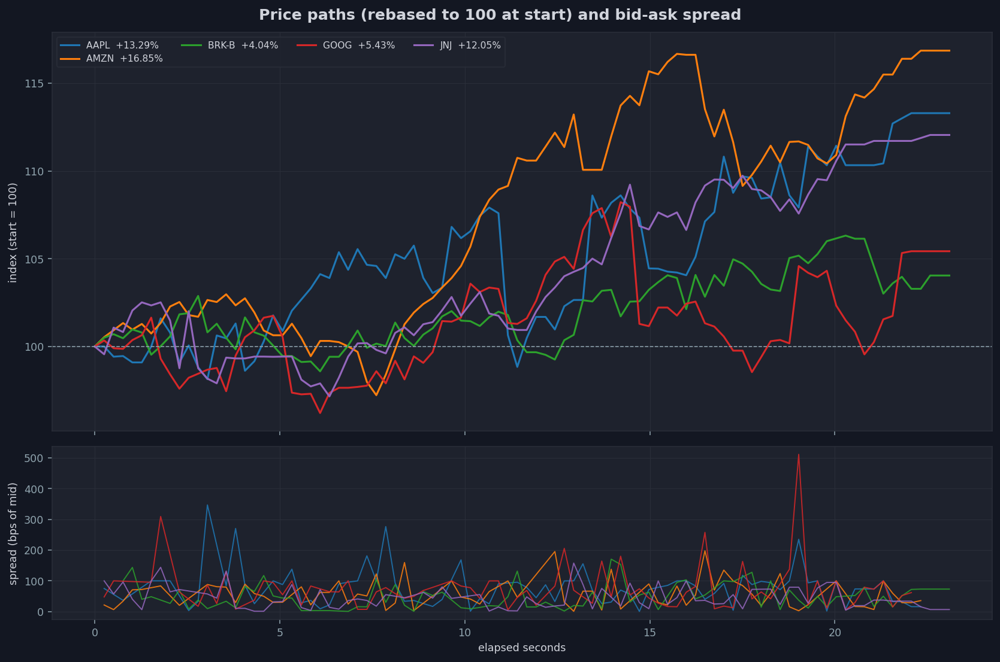
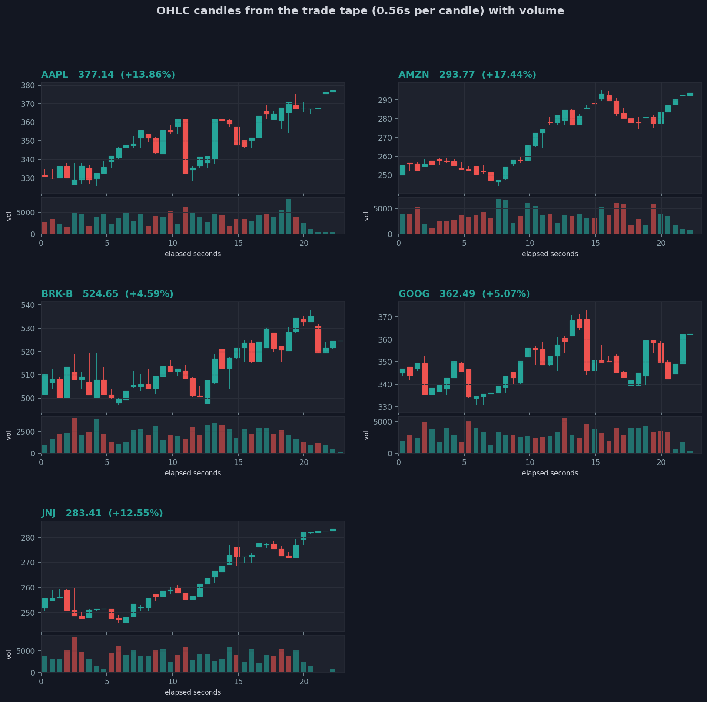
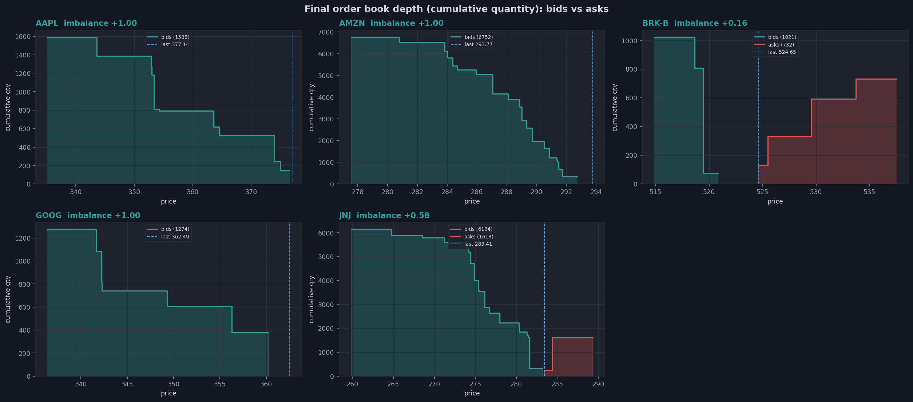
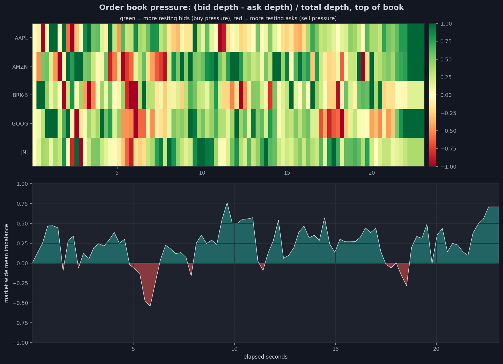
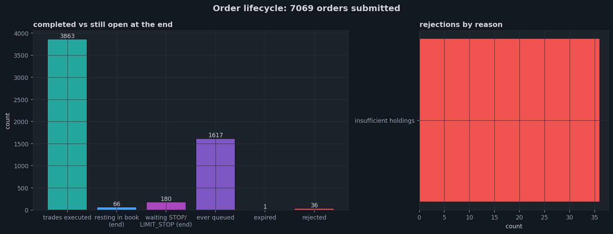
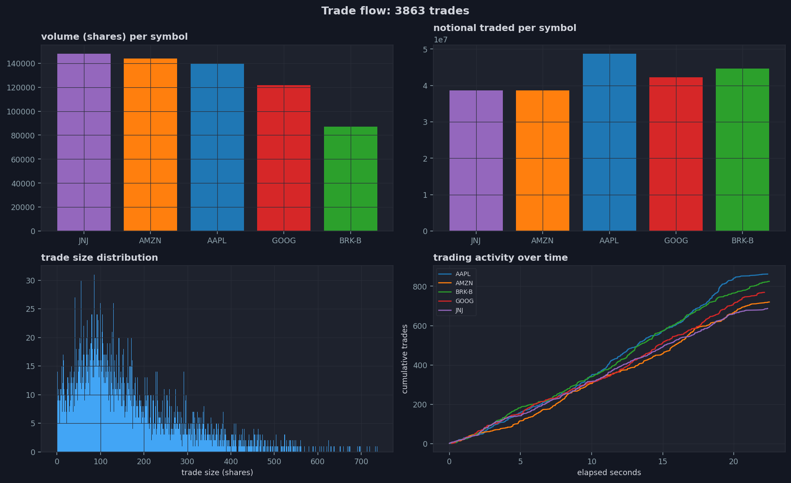
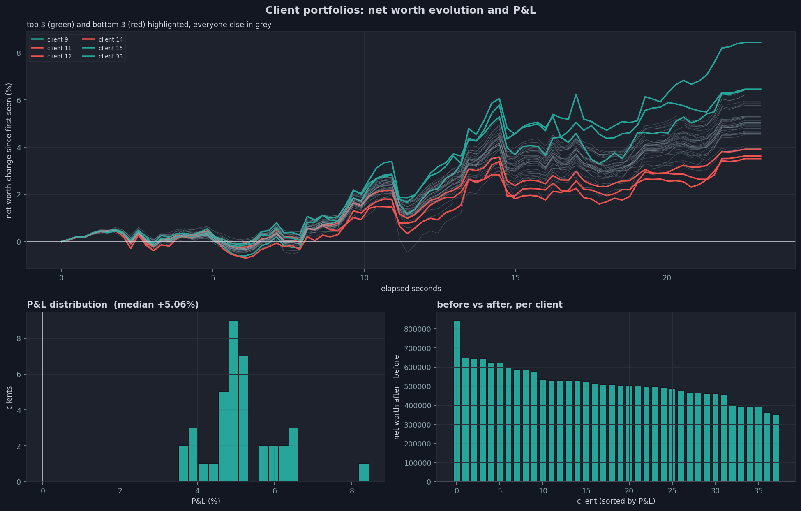
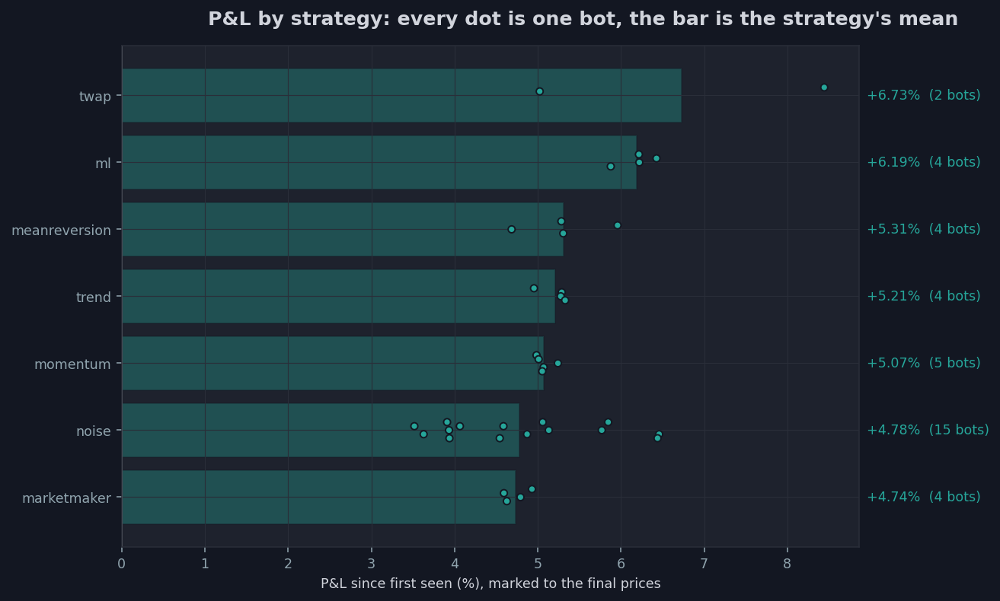
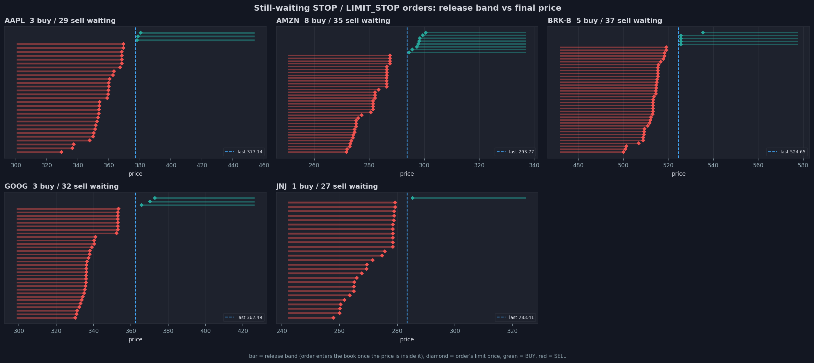
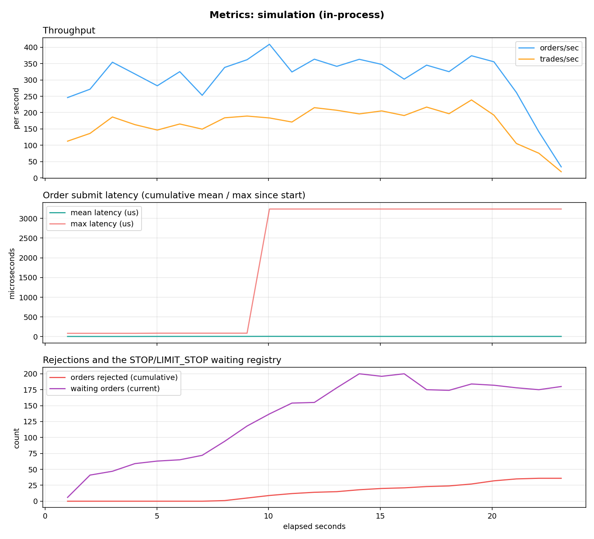

# Src_Simulation: a C++ stock exchange with trading bots
A dependency-free C++20 stock exchange (standard library only) where trading bots compete:

- a **matching engine** with price-time priority, four order kinds, time in force (DAY, GTC, dated orders), start dates and cash and share **reservations** so no account can ever be over-committed
- **seven bot strategies** (noise, momentum, market making, mean reversion, trend following, TWAP execution and a machine-learning signal), written once and run either in-process or as real network clients
- a **multi-threaded TCP server and client** with a framed text protocol, hashed passwords, session tokens and persistence across restarts, where a session ends like a **trading day** (pre-close, closing auction, DAY orders expiring, GTC orders carried to the next day)
- an **end-of-run market report**: CSV files for every trade, order and portfolio, turned into charts and an HTML page

Measured on the run shown below (38 bots, 5 real tickers, a laptop): **300 orders per second, 6.7 µs mean order submission time**.

**Contents**: 
1. [Quick start](#1-quick-start)
2. [A run, file by file](#2-a-run-file-by-file) ·
3. [Programs and scripts](#3-programs-and-scripts)
4. [Architecture and design choices](#4-architecture-and-design-choices) ·
5. [The exchange](#5-the-exchange)
6. [The bots](#6-the-bots)
7. [Client and server](#7-client-and-server) ·
8. [A session is a trading day](#8-a-session-is-a-trading-day)
9. [Real market data](#9-real-market-data) ·
10. [Measured numbers](#10-measured-numbers) ·
11. [Testing](#11-testing)
12. [Known limitations](#12-known-limitations) ·


## 1. Quick start
```bash
cd Src_Simulation
./launch.sh                                # builds, runs both phases (~45 s), writes logs, CSVs, charts
open output/latest/plots/index.html        # both reports
```
`launch.sh` runs two phases into one run folder:
1. **simu**: `simulation.x`, 36 bots of 7 strategies trading in-process (no network between the bots and the engine: the large, fast phase)
2. **bots**: `sim_server.x` plus 9 bots, each one a separate `sim_client.x` process trading through the TCP protocol, exactly as a human client would

What the console shows in a real run:
```text
################ run folder: /Users/tomcuel/Documents/Informatique-Code/GitHub/Stock_Market_Simulator_RL_Bots/Src_Simulation/output/20261006_001903
################ phase 1: in-process simulation (simulation.x)
==> Building simulation.x
==> Running simulation.x for 20s on 5 symbols (bots: 15 noise, 5 momentum, 4 market maker, 4 mean reversion, 4 trend, 2 twap, 4 ml)
    log: Src_Simulation/output/20261006_001903/logs/simulation_simu.log
=== Simulation report (23.1176s) ===
output: Src_Simulation/output/20261006_001903
  metrics_simu.csv  (plot: python3 scripts/plot_metrics.py Src_Simulation/output/20261006_001903)
  market report *_simu.csv  (plot: python3 scripts/plot_market_report.py Src_Simulation/output/20261006_001903)
orders_submitted=7069 orders_accepted=6013 orders_rejected=36 orders_queued=1617 orders_expired=1 trades_executed=3863 volume_traded=640175 orders_per_sec=305.784 trades_per_sec=167.102 | submit_latency: count=6013 mean_us=6.74971 max_us=3238 buckets(<us:count)=[10:4871, 50:1114, 100:25, 500:2, 1000:0, 5000:1, 50000:0, overflow:0]
waiting_orders=180 (STOP/LIMIT_STOP orders still waiting for their release band, or a future start date)

-- Symbols --
AAPL: last=377.135 vwap=348.732 volume=139711 best_bid=376.53
AMZN: last=293.77 vwap=268.848 volume=143779 best_bid=292.725
BRK-B: last=524.645 vwap=513.037 volume=86946 best_bid=520.823 best_ask=524.645
GOOG: last=362.486 vwap=347.335 volume=121753 best_bid=360.253
JNJ: last=283.405 vwap=261.262 volume=147986 best_bid=283.218 best_ask=283.405

-- Strategies --
marketmaker: bots=4 mean_pnl=473677 orders_placed=1546 orders_retracted=1389
meanreversion: bots=4 mean_pnl=530933 orders_placed=216 orders_retracted=63
ml: bots=4 mean_pnl=618577 orders_placed=660 orders_retracted=100
momentum: bots=5 mean_pnl=507313 orders_placed=476 orders_retracted=31
noise: bots=15 mean_pnl=478064 orders_placed=2691 orders_retracted=151
trend: bots=4 mean_pnl=521272 orders_placed=1087 orders_retracted=756
twap: bots=2 mean_pnl=673379 orders_placed=357 orders_retracted=92

-- Top 5 clients by net worth --
client 33: net_worth=1.08444e+07
client 9: net_worth=1.06459e+07
client 15: net_worth=1.0644e+07
client 36: net_worth=1.06428e+07
client 37: net_worth=1.06221e+07

==> Plotting (metrics, then market report)
metrics_simu.csv: 23 samples over 23.1s, 7069 orders, 3863 trades, mean latency 6.7us, max 3238us
saved Src_Simulation/output/20261006_001903/plots/metrics_simu.png
    report: Src_Simulation/output/20261006_001903/plots/report_simu.html
==> Done: Src_Simulation/output/20261006_001903
################ phase 2: server + socket bots (sim_server.x + sim_client.x --bot)
==> Building sim_server.x and sim_client.x
==> Starting sim_server.x on port 8000 (log: Src_Simulation/output/20261006_001903/logs/server_bots.log)
==> Server symbols (every bot trades across all of them): MSFT JPM META JNJ GOOG BRK-B AMZN AAPL
==> Launching 9 bots for 20s, strategies round-robin: noise momentum marketmaker meanreversion trend twap ml
==> Final market state:
OK METRICS orders_submitted=710 orders_accepted=593 orders_rejected=2 orders_queued=119 orders_expired=0 trades_executed=176 volume_traded=26131 | submit_latency: count=593 mean_us=10.1231 max_us=45 buckets(<us:count)=[10:334, 50:259, 100:0, 500:0, 1000:0, 5000:0, 50000:0, overflow:0] waiting_orders=71
OK MARKET MSFT last=528.105053053099 vwap=528.509659919729 volume=2604 ask=527.048842946993
OK MARKET JPM last=339.508745965421 vwap=337.561196814642 volume=4241 bid=340.455954976236
OK MARKET META last=760.748128971743 vwap=751.352700622682 volume=1590 bid=760.748128971743 ask=763.48988590823
OK MARKET JNJ last=259.789740451025 vwap=256.781280607149 volume=2359 bid=257.844538319534 ask=260.439214802153
OK MARKET GOOG last=350.590868354707 vwap=345.741965374435 volume=3380 bid=347.46091069225
OK MARKET BRK-B last=504.260009765625 vwap=505.54274289197 volume=2145
OK MARKET AMZN last=249.539110586134 vwap=249.301731696397 volume=3914 bid=246.109204791518
OK MARKET AAPL last=328.211132428576 vwap=326.886109814946 volume=5898 ask=328.211132428576
==> Stopping the server (it writes the market report on shutdown)
    trades logged: 176 (grep TRADE Src_Simulation/output/20261006_001903/logs/server_bots.log)
==> Plotting (metrics, then market report)
metrics_bots.csv: 21 samples over 21.1s, 710 orders, 176 trades, mean latency 10.1us, max 45us
saved Src_Simulation/output/20261006_001903/plots/metrics_bots.png
    report: Src_Simulation/output/20261006_001903/plots/report_bots.html
==> Done: Src_Simulation/output/20261006_001903
################ done: /Users/tomcuel/Documents/Informatique-Code/GitHub/Stock_Market_Simulator_RL_Bots/Src_Simulation/output/20261006_001903
open /Users/tomcuel/Documents/Informatique-Code/GitHub/Stock_Market_Simulator_RL_Bots/Src_Simulation/output/20261006_001903/plots/index.html
```
**Common variations:**
```bash
./launch.sh simu --simu-duration 300 --symbols 8 --noise 60       # a bigger in-process run only
./launch.sh bots --bots 14 --bots-duration 60                     # the network session only
./launch.sh --refresh-data small                                  # fetch real prices first (needs network)
./launch.sh --train-ml --ml 4                                     # retrain the ML bots' model, 4 ML bots
./launch.sh --help                                                # every option
```
**Trade by hand:**
```bash
./sim_server.x                                              # terminal 1
./sim_client.x alice secret --register                      # terminal 2, then type commands ('help' lists them)
```
```text
OK REGISTERED client_id=1 token=<64 hex>
> SYMBOLS
OK SYMBOLS TSLA GOOG MSFT AAPL
> MARKET AAPL
OK MARKET AAPL last=180 vwap=0 volume=0
> ORDER BUY AAPL 100 LIMIT PRICE=170
OK ORDER order_id=1 status=RESTING filled=0
> ORDER BUY AAPL 50 LIMIT PRICE=150 TIF=GTC
OK ORDER order_id=2 status=RESTING filled=0
> PORTFOLIO
OK PORTFOLIO cash=5000030 reserved_cash=24500 available_cash=4975530 TSLA=5208 GOOG=7576 MSFT=3049 AAPL=6944
> CANCEL 1 AAPL
OK CANCELLED
> PORTFOLIO
OK PORTFOLIO cash=5000030 reserved_cash=7500 available_cash=4992530 ...
```
From another account, `mallory`: `CANCEL 2 AAPL` answers `ERR NOT_FOUND` (alice's order) and `ORDER BUY AAPL 10 LIMIT PRICE=170 TIF=WEEK` answers `ERR ORDER reason=TIF_must_be_DAY_or_GTC`.
Add bots to the same market whenever you like:
```bash
./sim_client.x bot1 pw --register --bot marketmaker --duration-sec 300
```


## 2. A run, file by file
Everything below comes from one real run with real fetched tickers, kept in the repository: [`output/20261006_001903/`](output/20261006_001903/). (`output/latest` is a symlink to the newest run on your machine, GitHub doesn't follow it)

### The run folder `output/20261006_001903/`
| File | What it is |
|---|---|
| `logs/simulation_simu.log` | The simulation: every trade (INFO level) and the end-of-run report |
| `logs/server_bots.log` | The server: every client command and its answer, every trade |
| `logs/bots/bot01_noise.log ...` | Each socket bot (`botNN_<strategy>`) |
| `logs/build_*.log`, `plot_report_*.log` | Build and plotting output |
| `metrics_simu.csv`, `metrics_bots.csv` | Throughput and latency, sampled every second |
| `summary_simu.csv`, `summary_bots.csv` | Totals (orders, trades, latency, cash before and after, overdrawn clients) |
| `symbols_simu.csv`, `...` | Per-symbol prices, VWAP, volume, spread, depth and imbalance |
| `trades_simu.csv` | Every trade |
| `price_samples_simu.csv` | Last price, best bid and ask and depth, every 250 ms |
| `portfolio_samples_simu.csv` | Cash and net worth per client, every 250 ms |
| `portfolios_final_simu.csv` | Per client: strategy, before and after, P&L and holdings |
| `resting_orders_simu.csv`, `waiting_orders_simu.csv`, `order_book_final_simu.csv`, `rejections_simu.csv` | Final order and rejection data |
| `plots/index.html` | Links to both reports |
| `plots/report_simu.html`, `plots/report_bots.html` | Simulation and bot reports |
| `plots/01_price_paths_simu.png ... 10_strategies_simu.png`, `metrics_simu.png` | Simulation plots (and the corresponding `_bots` set) |

The suffix says where a file comes from: `_simu` from `simulation.x`, `_bots` from `sim_server.x`, so both phases share one folder. 
Every path the programs print is relative to the project root.

### The text report
At the end of a run, `simulation.x` prints a report (here from `logs/simulation_simu.log`):
```
Seeding 5 symbols from Data/Datasets/processed/latest_snapshot.csv
Bots: 15 noise, 5 momentum, 4 market maker, 4 mean reversion, 4 trend, 2 twap, 4 ml (each trading across all 5 symbols)
[00:19:03.136] [INFO] [tid 0x1f837ff80] registered symbol AAPL reference_price=332.89
...
[00:19:26.254] [INFO] [tid 0x1f837ff80] market report written to Src_Simulation/output/20261006_001903 (3863 trades, 66 resting, 180 waiting orders)
[00:19:26.255] [INFO] [tid 0x1f837ff80] simulation finished

=== Simulation report (23.1176s) ===
output: Src_Simulation/output/20261006_001903
... # as previously shown in the console output :
client 37: net_worth=1.06221e+07
```

### The plotting summary
`scripts/plot_market_report.py` reads the CSVs, draws the charts and prints a summary (`logs/plot_report_simu.log`):
```
[simulation (in-process)]
==============================================================================
Market report: 23.1s, 5 symbols, 38 clients
==============================================================================
orders submitted 7069, trades 3863, volume 640175, notional 212,935,186.17
end state: 66 resting, 180 waiting, 1 expired, 36 rejected
cash conservation check: 190,001,475.50 before, 190,001,475.50 after (OK)

Per symbol, before -> after:
symbol  initial_price  final_price  change_pct  trades  volume   vwap  spread  imbalance  resting_orders  waiting_orders
  AAPL         332.89       377.14       13.29     862  139711 348.73     NaN       1.00              10              32
  AMZN         251.40       293.77       16.85     720  143779 268.85     NaN       1.00              21              43
 BRK-B         504.26       524.65        4.04     825   86946 513.04    3.82       0.16               8              42
  GOOG         343.83       362.49        5.43     769  121753 347.33     NaN       1.00               6              35
   JNJ         252.93       283.41       12.05     687  147986 261.26    0.19       0.58              21              28

By strategy (P&L in % since first seen):
               bots  mean_pnl_pct  best_pnl_pct  worst_pnl_pct  trades
strategy                                                              
twap              2         +6.73         +8.44          +5.02     230
ml                4         +6.19         +6.43          +5.88     415
meanreversion     4         +5.31         +5.96          +4.69     111
trend             4         +5.21         +5.33          +4.96     192
momentum          5         +5.07         +5.24          +4.99     266
noise            15         +4.78         +6.46          +3.52    2226
marketmaker       4         +4.74         +4.93          +4.59     423

Top 5 / bottom 5 clients by P&L:
 client label  initial_net_worth  final_net_worth        pnl  pnl_pct  trades_as_buyer  trades_as_seller
     33  twap           10000000    10,844,352.52 844,352.52     8.44              124                63
      9 noise           10000000    10,645,942.62 645,942.62     6.46              147               138
     15 noise           10000000    10,644,020.47 644,020.47     6.44              148               158
     36    ml           10000000    10,642,771.77 642,771.77     6.43              114                54
     37    ml           10000000    10,622,104.49 622,104.49     6.22              101                50
      5 noise           10000000    10,393,899.06 393,899.06     3.94              148               140
     13 noise           10000000    10,393,419.35 393,419.35     3.93              146               153
     11 noise           10000000    10,391,081.15 391,081.15     3.91              139               166
     14 noise           10000000    10,362,924.19 362,924.19     3.63              142               138
     12 noise           10000000    10,351,753.37 351,753.37     3.52              143               153

wrote 11 charts and Src_Simulation/output/20261006_001903/plots/report_simu.html
```
The **cash conservation check** is the exchange's own audit: cash only moves between clients, so the total must be identical before and after.

**Reading the P&L honestly**: every strategy gained between 3.5% and 8.4% here, because every price rose (4.0% to 16.8%) and every bot starts half in stock. 
This run's P&L mostly measures the market's rise, not the strategies' skill: compare strategies with each other, over several runs and seeds, rather than reading one run's absolute numbers.

### The HTML report and the charts
`plots/report_simu.html` puts the summary and every chart on one page and `plots/index.html` links the reports of both phases. 
The charts of this run:

| | |
|---|---|
| **01 before and after**: price change per symbol, with daily returns | **03 candles**: OHLC candles and volume built from the trade tape (the launchers make one candle one ML bar, a simulated trading day) |
|  |  
| **04 depth**: the final order book, bids against asks | **05 book pressure**: order book imbalance over time, per symbol |
|  |  |
| **06 order lifecycle**: where the orders ended up and why some were rejected | **08 trade flow**: volume, notional and trade sizes per symbol |
|  |  |
| **07 portfolios**: net worth over time and the P&L distribution | **7 strategies**: P&L by strategy, one dot per bot |
|  |  |
| **09 waiting orders**: every waiting STOP's trigger band against the final price | **metrics**: throughput and latency over the run |
|  |  |

The network phase produces the same set with the `_bots` suffix, for example [its candles](output/20261006_001903/plots/03_candles_bots.png) and [its strategies](output/20261006_001903/plots/10_strategies_bots.png).

### The logs
`logs/server_bots.log` holds every command a client sent and the answer it got, then every trade:
```
Seeded 8 symbols from ../Data/Datasets/processed/latest_snapshot.csv
[00:19:31.375] [INFO] [tid 0x1f837ff80] registered symbol AAPL reference_price=332.89
...``
[00:19:31.376] [INFO] [tid 0x1f837ff80] SimulationServer listening on port 8000
Server running on port 8000. Symbols: AAPL AMZN BRK-B GOOG JNJ JPM META MSFT 
Metrics: appending to Src_Simulation/output/20261006_001903/metrics_bots.csv every 1000ms
Market report: recording, will be written to Src_Simulation/output/20261006_001903 (*_bots.csv) on shutdown
Press Ctrl-C to stop
[00:19:31.383] [INFO] [tid 0x16f573000] REGISTER username=launcher -> client_id=1
[00:19:31.384] [INFO] [tid 0x16f573000] client=1 command=[SYMBOLS] response=[OK SYMBOLS MSFT JPM META JNJ GOOG BRK-B AMZN AAPL]
[00:19:31.396] [INFO] [tid 0x16f573000] REGISTER username=bot01_noise -> client_id=2
...
[00:19:51.675] [INFO] [tid 0x16f573000] client=1 command=[MARKET AAPL] response=[OK MARKET AAPL last=328.211132428576 vwap=326.886109814946 volume=5898 ask=328.211132428576]
Shutting down...
[00:19:52.474] [INFO] [tid 0x1f837ff80] SimulationServer stopped
[00:19:52.485] [INFO] [tid 0x1f837ff80] market report written to Src_Simulation/output/20261006_001903 (176 trades, 12 resting, 71 waiting orders)
Market report written to Src_Simulation/output/20261006_001903 (plot, from the project root: python3 Src_Simulation/scripts/plot_market_report.py Src_Simulation/output/20261006_001903)
```
and `logs/bots/botNN_<strategy>.log` each socket bot's orders and the server's answers.


## 3. Programs and scripts
### `simulation.x`: the in-process simulation
```bash
./simulation.x                                         # 3 symbols, 10 s, text report only
./simulation.x --symbols 5 --duration 60 --output-dir output/my_run
```
| Option | Default | Effect |
|---|---|---|
| `--symbols N`, `--duration SEC` | 3, 10 | market size and length |
| `--noise`, `--momentum`, `--marketmakers`, `--meanreversion`, `--trend`, `--twap`, `--ml N` | 15, 5, 4, 4, 4, 2, 2 | bots of each strategy |
| `--ml-model PATH`, `--ml-bar-ms N` | `models/signal_model.csv`, 1000 | the ML bots' model and bar: one simulated trading day ([section 6](#the-ml-bot)) |
| `--bot-equity X`, `--cash-fraction F` | 10 million, 0.5 | every bot's starting account |
| `--seed N` | 42 | reproducible random draws |
| `--data-seed PATH` / `--no-data-seed` | the fetched snapshot | real tickers and prices, or demo tickers |
| `--output-dir DIR` | none | write the metrics and the market report |
| `--log-level`, `--metrics-interval-ms`, `--report-interval-ms`, `--no-metrics`, `--no-report` | INFO, 1000, 250 | logging and sampling |

### `sim_server.x`: the exchange server
```bash
./sim_server.x --port 7878 --output-dir output/session
./sim_server.x --snapshot output/day.snapshot --closing-auction 5     # persistence and trading days
```
| Option | Default | Effect |
|---|---|---|
| `--port N` | 7878 | listen port |
| `--snapshot PATH`, `--save-interval SEC` | off, 30 | persistence: accounts, positions, prices, surviving orders |
| `--closing-auction SEC` | off | on stop: pre-close, closing auction, DAY orders expire ([section 8](#8-a-session-is-a-trading-day)) |
| `--starting-equity X`, `--cash-fraction F` | 10 million, 0.5 | every new account |
| `--data-seed PATH` / `--no-data-seed`, `--max-symbols N` | the fetched snapshot, 8 | listed tickers |
| `--output-dir DIR`, `--no-log-commands`, `--log-level` | | report, metrics, logging |

### `sim_client.x`: a human client or a bot
```bash
./sim_client.x alice secret --register                # interactive, type 'help'
./sim_client.x alice secret                           # next times: LOGIN
./sim_client.x bot1 pw --register --bot trend --duration-sec 60
```
Bot options: `--bot noise|momentum|marketmaker|meanreversion|trend|twap|ml`, `--symbols S1 S2 ...`, `--duration-sec`, `--min-interval-ms`, `--max-interval-ms`, `--seed`, `--ml-model`, `--ml-bar-ms`, `--quiet`.

### Scripts
| Script | What it does |
|---|---|
| `launch.sh` | both phases (or `simu` / `bots`) into one run folder, charts, `index.html` |
| `scripts/launch_simulation.sh` | the in-process phase alone, every bot count as an option |
| `scripts/launch_bots.sh` | server plus N socket bots (strategies round-robin), `--closing-auction SEC` ends the session with a trading day close |
| `scripts/refresh_data.sh` | fetches real data through the `Data/` pipeline, then retrains the ML model (`--no-train` to skip) |
| `scripts/train_signal_model.py` | trains the ML bots' model on the fetched market, `--check-run` compares a run with it |
| `scripts/ml_model.sh` | used by the launchers: trains the model when ML bots are asked for and none exists |
| `scripts/plot_metrics.py`, `scripts/plot_market_report.py` | the charts and the HTML report |

Every script starts with a header describing its usage, options and defaults, also printed by `--help`.


## 4. Architecture and design choices
```
include/ and src/
  types.hpp                          orders, trades, sides, order kinds, time in force
  portfolio.hpp                      cash, holdings and what open orders reserve
  order_book.hpp/.cpp                one symbol's book: price-time priority, cancels, the auction uncross
  order_registry.hpp/.cpp            orders waiting for a trigger or a start date, bucketed by symbol
  matching_engine.hpp/.cpp           submission, reservations, settlement, releases, auctions, expiry
  notification.hpp                   asynchronous event bus (trades, rejections, queued, expired)
  market_data.hpp/.cpp               candles, VWAP, volume (a bus subscriber)
  market_recorder.hpp/.cpp           records a run, writes the market report
  gateway.hpp/.cpp                   what a strategy can see and do (in-process implementation)
  bot.hpp/.cpp                       the strategy base class, the seven strategies, the thread runner
  signal_model.hpp/.cpp              the ML features and the logistic model
  simulation.hpp/.cpp, main.cpp      simulation.x
  market_seed.hpp/.cpp               real tickers and volatility from Data/
  metrics.hpp, logger.hpp, paths.hpp counters and latency histogram, logging, root-relative paths
  net/protocol                       framing: an 8-byte length then the text, 1 MiB cap
  net/auth, net/sha256               accounts, salted password hashes, session tokens
  net/simulation_server              the TCP server, one thread per client, the command protocol
  net/wire_gateway                   the gateway over the protocol (socket bots)
  net/persistence                    the snapshot: accounts, positions, prices, surviving orders
  net/client_connection, sim_server_main.cpp, sim_client_main.cpp
```
The key design choice: **a strategy only talks to a `MarketGateway`** (symbols, quote, portfolio, submit, cancel). 
`InProcessGateway` calls the engine, `WireGateway` sends the same requests as protocol commands. 
So every strategy is written once and runs unchanged in `simulation.x` and in `sim_client.x --bot` and the client never links the engine.

**Lessons applied from `Test_Functionnalities`**:
- **Framing** (`Sockets/Socket_Size`): every message is an 8-byte big-endian length then exactly that many bytes, with a 1 MiB cap and a receive timeout: a peer claiming a huge length is rejected, a stalled peer can't block a server thread forever.
- **Passwords** (`Password_Cryptage`): deliberately not AES like that experiment. Passwords are salted and hashed one way with SHA-256 (`net/sha256.hpp`, checked against the standard test vectors), never stored in a recoverable form: a password never needs to be read back and the engine stays free of OpenSSL.
- **Separated mutexes** (`Mutex/Separated_Mutex`): one lock per subsystem instead of a global one, so a scan of waiting orders, a portfolio lookup and matching on another symbol never wait for each other.
- **Thread per connection with a clean shutdown** (`Sockets/Launcher`, `Multi_Thread`): the server accepts in a `select()` loop with a timeout, so it notices a stop within a second instead of blocking in `accept()` and `launch_bots.sh` spawns the bots like the `Launcher` experiment.

**Why MARKET orders have no placeholder price**: the `Src_SQL` bug (a MARKET order stored with a fake price like `UINT16_MAX`, which corrupts priority and settlement as soon as it is compared or used) can't come back: MARKET orders are strictly immediate or cancel, any unfilled part is discarded instead of resting with a fake price (NRT `unfilled_market_order_does_not_rest_in_book`, `partially_filled_market_order_discards_remainder`). Their only price is the collar, a protection limit.

**Extending it**:
- a new strategy: subclass `TradingStrategy` (`bot.hpp`), implement `on_tick()` with `place()`, `retract()`, `history()` and `lots()` and add its name to `strategy_names()` and `make_strategy()` (`bot.cpp`). It then runs in `simulation.x`, as `sim_client.x --bot <name>` and in the launchers' rotation, with no other change
- a new wire command: a branch in `SimulationServer::dispatch_command()` (`net/simulation_server.cpp`) and in `WireGateway` (`net/wire_gateway.cpp`) if bots should use it
- new symbols: they come from the `Data/` seed file (section 9), or the demo list in `main.cpp` and `net/sim_server_main.cpp`.


## 5. The exchange
**Order kinds**
| Kind | Enters the book | Notes |
|---|---|---|
| `MARKET` | immediately, never rests | trades inside a collar of +/-10% around the last price, the rest is discarded (to assess the client current position when calculating financial capacity) |
| `LIMIT` | immediately, rests if not filled | at its price or better |
| `STOP` | when the price reaches its trigger | side-aware: a SELL stop fires when the price falls to it, a BUY stop when it rises to it |
| `LIMIT_STOP` | when the price is inside `[trigger_lower, trigger_upper]` | then behaves as a LIMIT |

Any order can also carry a start date (`NOT_BEFORE`) and an expiry date (`EXPIRES`) and a time in force ([section 8](#8-a-session-is-a-trading-day)).

A **watcher** (a thread in `sim_server.x`, the release watcher in `simulation.x`) calls `MatchingEngine::try_release_waiting_orders()`, which submits every waiting order whose band and start date are now satisfied into the live book, mirroring `Src_SQL`'s `trigger_and_expiration_watcher`. The scan doesn't touch every symbol on every tick: `OrderRegistry` buckets waiting orders by symbol and the engine tracks which symbols traded since the last scan, so a tick only rescans those. A full sweep still runs periodically for orders waiting only on a start date, which no trade would ever mark.

**Reservations: open orders are not debited, but they are reserved.** A client keeps owning the cash and shares its open orders engage until they trade. Each accepted order sets its worst case aside (a BUY reserves quantity x limit price, the collar for a MARKET buy, a SELL its shares), a new order is checked against what is still available and fills, cancels and expiries release exactly what they used. Without this, a bot of a real run ended at -18768.89 cash.

**Cancels are owner-checked**: a client can only cancel its own orders, anyone else's answers `ERR NOT_FOUND` exactly like a missing one (order ids are sequential and guessable).

**Concurrency**: each book has its own lock, the maps of books, prices and portfolios have separate locks, the waiting registry and the event bus their own. Consumers of events (market data, the recorder, logging) run on the bus's thread, so they never slow order submission down. The [NRT](../NRT/README.md) suite stress-tests every lock, also under AddressSanitizer.


## 6. The bots
Every bot gets the same balanced account: 10 million, half in cash and half split **equally by value**
across the symbols and sizes its orders in **lots** of 0.2% of that equity converted to shares, so an order on a 500 stock weighs the same as one on a 50 stock. Every bot trades the whole market (a symbol is picked each tick) and **retracts its own stale orders** after a maximum age, which matters since open orders reserve cash.
| Strategy | Idea | Orders |
|---|---|---|
| `noise` | random retail flow around the last price | every kind, some with expiry dates |
| `momentum` | follows a significant move over 10 samples, with a cooldown per symbol | MARKET entry, protective STOP |
| `marketmaker` | quotes both sides around the mid, leaning with its inventory (capped so it never crosses) | a LIMIT pair, re-posted every tick |
| `meanreversion` | z-score against the 20-sample mean, acts beyond 1.5 | one passive LIMIT per symbol |
| `trend` | 5 / 20 sample moving average crossover | MARKET entry, trailing STOP re-placed as the price moves |
| `twap` | works a large parent order in slices, crosses the spread only when behind schedule | LIMIT child orders, logs its slippage |
| `ml` | logistic regression trained in Python, one decision per bar (a simulated trading day) | MARKET entry on a clear signal, protective STOP, closed after the model's horizon |

### The ML bot
The `ml` bots trade with a logistic regression predicting whether a price will be higher 5 bars ahead, from five features (`ret_1`, `ret_5`, `ma_gap_10`, `vol_10`, `rsi_14`). Python trains it, C++ evaluates it (a dot product per decision, no Python during the run). **It learns from the real market** fetched by the `Data/` pipeline, 5 years of daily closes per ticker by default (`--history-length 1250`), no previous simulation needed:
```bash
scripts/refresh_data.sh small          # fetch, preprocess, features, then retrain the model
```
```text
==> Refreshing market data: mode=small period=5y interval=1d history=100 bars (min 30)
Fetching AAPL ...
...
Fetching JNJ ...
Wrote 12541 rows for 10 tickers to /Users/tomcuel/Documents/Informatique-Code/GitHub/Stock_Market_Simulator_ML_Bots/Data/Datasets/raw/launcher_small_fetched_data.csv
Loading (long format, fetched) /Users/tomcuel/Documents/Informatique-Code/GitHub/Stock_Market_Simulator_ML_Bots/Data/Datasets/raw/launcher_small_fetched_data.csv
Wrote 1000 rows across 10 tickers to /Users/tomcuel/Documents/Informatique-Code/GitHub/Stock_Market_Simulator_ML_Bots/Data/Datasets/processed/all_prices.csv
Wrote 1000 rows of features to /Users/tomcuel/Documents/Informatique-Code/GitHub/Stock_Market_Simulator_ML_Bots/Data/Datasets/processed/features.csv
Wrote latest per-ticker snapshot (10 tickers) to /Users/tomcuel/Documents/Informatique-Code/GitHub/Stock_Market_Simulator_ML_Bots/Data/Datasets/processed/latest_snapshot.csv
==> Seed file updated: Data/Datasets/processed/latest_snapshot.csv
==> Retraining the ML bots' model on the fresh data
    10 series from Data/Datasets/processed/all_prices.csv
    train 560 points, test 250 points (test = the later part of every series)
    accuracy  train 0.639  test 0.456 (naive baseline on test: 0.536)
      weight ret_1      +0.1089
      weight ret_5      +0.1689
      weight ma_gap_10  -0.1314
      weight vol_10     -0.3344
      weight rsi_14     -0.3989
    model written to Src_Simulation/models/signal_model.csv
```
**Days and bars:** The model learns from one close per trading day, while a simulation moves tick by tick. So the bot reads the market in **bars**, one bar playing one trading day:
- **one second by default** (`--ml-bar-ms 1000`): measured on a real run, one second of simulation moves real tickers as much as a real day (below)
- **on a fixed grid**: bar *n* covers [*n*, *n* + 1) seconds of the machine's monotonic clock, shared by every process, so every ML bot, in-process or over the network, sees the same bars, without drift
- **one candle = one bar**: the launchers draw the candle chart with the bar's width, so the chart reads a daily candles, the very closes the bot's features are computed from

We then launch a simulation with 4 ML bots and check the model's bars against the training days:
```bash
./launch.sh simu --simu-duration 30 --ml 4
python3 scripts/train_signal_model.py --check-run output/latest --bar-ms 500
```
The first command launches a simulation with 4 ML bots. 
The second prints the comparison table and a suggested `--ml-bar-ms` : 
- `--check-run` compares a run's bars with the training days
- Returns grow with the square root of time, so the suggested bar is the one whose moves are as large as avreal trading day's. Matching the volatility is necessary, not sufficient: the other ratios show how the simulated market's shape still differs.
```text
################ run folder: /Users/tomcuel/Documents/Informatique-Code/GitHub/Stock_Market_Simulator_ML_Bots/Src_Simulation/output/20261006_001022
################ phase 1: in-process simulation (simulation.x)
==> Building simulation.x
==> Running simulation.x for 30s on 5 symbols (bots: 15 noise, 5 momentum, 4 market maker, 4 mean reversion, 4 trend, 2 twap, 4 ml)
...
```
```text
training: 860 points from Data/Datasets/processed/all_prices.csv, run: 265 bars of 500 ms from Src_Simulation/output/20261006_001022
feature       training std    run std   ratio   (ratio near 1: the run looks like the training period)
ret_1              0.02263    0.01864    0.82
ret_5              0.05035    0.03628    0.72
ma_gap_10          0.03645    0.02614    0.72
vol_10             0.01011    0.00769    0.76
rsi_14             0.29921    0.24500    0.82
one-bar returns are 0.82 times as volatile as one-day returns: a bar of about 736 ms would match a trading day (simulation.x --ml-bar-ms 736)
```
**The model has no edge yet**: trained on only 100 days per ticker (the former default), it scored 0.456 test accuracy against a 0.540 naive baseline and inside the simulation its accuracy matched the "always up" baseline of a rising run. 
Retrain it on 5 years (`scripts/refresh_data.sh small`) and judge it over runs of several minutes and several seeds. 
The ML bot is the plumbing (training, a model file, native inference, bars, positions sized and closed like the model's labels) for the richer models that could be implemented.


## 7. Client and server
One command per framed message in, one answer per framed message out, every answer starting with `OK` or `ERR`. 
`REGISTER`, `LOGIN` or `RESUME` must succeed before anything else is accepted on a connection.
```text
REGISTER <username> <password>        -> OK REGISTERED client_id=1 token=<64 hex>
LOGIN <username> <password>           -> OK LOGIN client_id=1 token=<64 hex>
RESUME <token>                        -> reconnect without the password
ORDER <BUY|SELL> <SYMBOL> <QTY> <MARKET|LIMIT|STOP|LIMIT_STOP>
      [PRICE=p] [TRIGGER=t] [TRIGGER_LOWER=l] [TRIGGER_UPPER=u] [EXPIRES=sec] [NOT_BEFORE=sec] [TIF=DAY|GTC]
                                      -> OK ORDER order_id=1 status=RESTING|FILLED|QUEUED|NO_LIQUIDITY filled=N
                                         ERR ORDER order_id=7 reason=insufficient cash   (or market closed, ...)
                                         ERR ORDER reason=TIF_must_be_DAY_or_GTC         (a malformed command)
CANCEL <order_id> <SYMBOL>            -> OK CANCELLED | ERR NOT_FOUND
CANCEL_WAITING <order_id>, CANCEL_BOOK <order_id> <SYMBOL> <BUY|SELL> <price>
PORTFOLIO                             -> OK PORTFOLIO cash=.. reserved_cash=.. available_cash=.. AAPL=6944 ...
MARKET <SYMBOL>                       -> OK MARKET AAPL last=.. vwap=.. volume=.. bid=.. ask=..
SYMBOLS, METRICS, QUIT
```
A `STOP`'s resting price defaults to its trigger when no `PRICE=` is given.

**Robustness**: messages are framed (8-byte length prefix, 1 MiB cap, receive timeout), so they never run together. 
Passwords are salted and hashed (SHA-256), never stored or logged in clear. 
A client that vanishes mid-reply only fails its own connection (`MSG_NOSIGNAL` on Linux, `SO_NOSIGPIPE` on macOS) and a bad command gets an error answer instead of crashing the server.


## 8. A session is a trading day
Every order has a **time in force**, as on real exchanges:
| | lives until | how |
|---|---|---|
| DAY | the close | the default without an expiry date |
| GTC (good till cancelled) | filled or cancelled, across sessions | `TIF=GTC` |
| good till date | its own expiry date, across sessions | `EXPIRES=sec` |

With `sim_server.x --snapshot FILE --closing-auction SEC`, stopping the server ends the day:
1. **pre-close**: for SEC seconds orders are accepted (and reserved) but nothing matches, the books may cross
2. **the market closes**: new orders are rejected (`market closed`)
3. **closing auction**: per symbol, the single price executing the most volume (ties: the smallest unmatched quantity, then the price closest to the last trade, the fixing rule of `Src_SQL`), every crossing order trades at it and it becomes the official close
4. **DAY orders expire** (and any MARKET order left and any order past its date), releasing their reservations
5. **snapshot**: accounts, positions, closing prices and every surviving order, with its id, its place in the queue and the trading time it had left (an order's clock stops while the market is closed)

The next start reloads it all, rebuilds the reservations from the restored orders and opens with an auction (after a normal close the book can't cross, but after a crash during the pre-close it can).

### A socket session ending with a closing auction
```bash
scripts/launch_bots.sh --duration 30 --closing-auction 8
grep -E "Pre-close|close |expired|carried" output/latest/logs/server_bots.log
```
Expect the `Pre-close` line, one `close SYMBOL price` (...) line per symbol and the count of DAY orders expired and GTC orders carried over.
```text
==> Building sim_server.x and sim_client.x
...
==> Done: Src_Simulation/output/20261006_001231
```
In the server's log, the watcher releases the STOP orders before the close, then the closing auction's trades appear at the closing price after it has been fixied
```text
...
[00:12:39.149] [INFO] [tid 0x1f837ff80] registered symbol MSFT reference_price=525.18
...
[00:12:41.556] [INFO] [tid 0x16badb000] TRADE MSFT qty=116 price=526.893 buyer=2 seller=2
...
[00:12:51.340] [INFO] [tid 0x16bc7f000] watcher: released 2 order(s), expired 0 order(s)
...
[00:13:00.375] [INFO] [tid 0x16bc7f000] watcher: released 4 order(s), expired 0 order(s)
...
[00:13:09.450] [INFO] [tid 0x16c1f7000] client=10 command=[MARKET AAPL] response=[OK MARKET AAPL last=336.198240095314 vwap=331.107613249468 volume=6872 bid=369.818064104845 ask=302.578416085783]
Pre-close: 8s of order collection (nothing matches), then the closing auction
  close MSFT 518.43 (closing auction, 1224 shares)
...
[00:13:09.580] [INFO] [tid 0x16badb000] TRADE MSFT qty=70 price=518.43 buyer=8 seller=9
[00:13:09.580] [INFO] [tid 0x16badb000] TRADE MSFT qty=112 price=518.43 buyer=8 seller=2
...
132 DAY order(s) expired (reservations released), 6 GTC / dated order(s) carried over to the next session
...
```

### Two trading days with a GTC order carried ove
two terminals in `Src_Simulation`:
```bash
# terminal 1: day 1
./sim_server.x --snapshot output/day.snapshot --closing-auction 5

# terminal 2: one DAY order and one GTC order, then a look at the reservation
printf 'ORDER BUY AAPL 10 LIMIT PRICE=100\nORDER BUY AAPL 100 LIMIT PRICE=150 TIF=GTC\nPORTFOLIO\nquit\n' | ./sim_client.x alice pw --register
```
```text
APL 100 LIMIT PRICE=150 TIF=GTC\nPORTFOLIO\nquit\n' | ./sim_client.x alice pw --register

OK REGISTERED client_id=1 token=a14941dea31e00e3a356e466ddfbbf9baee16d246a321ae76a276c23b650e4da
Connected. Type 'help' for the command list, 'quit' to disconnect.
OK ORDER order_id=1 status=RESTING filled=0
OK ORDER order_id=2 status=RESTING filled=0
OK PORTFOLIO cash=5000815.55706787 reserved_cash=16000 available_cash=4984815.55706787 MSFT=1190 JPM=1880 GOOG=1818 META=842 JNJ=2471 BRK-B=1239 AMZN=2486 AAPL=1877
```
The two bids reserve 10 x 100 + 100 x 150 = 16000: alice still owns that cash, but can't engage it twice. Ctrl-C in terminal 1 ends the day:
```
Shutting down...
Pre-close: 5s of order collection (nothing matches), then the closing auction
  close MSFT 525.18 (no cross: last traded price)
  ...
  close AAPL 332.89 (no cross: last traded price)
  1 DAY order(s) expired (reservations released), 1 GTC / dated order(s) carried over to the nextsession
[00:16:49.651] [INFO] [tid 0x16d28f000] ORDER_EXPIRED order_id=1 client=1 symbol=AAPL
[00:16:57.279] [INFO] [tid 0x1f837ff80] persistence: snapshot saved to Src_Simulation/output/day.snapshot
[00:16:57.279] [INFO] [tid 0x1f837ff80] SimulationServer stopped
```
The snapshot keeps the GTC bid:
```bash
# terminal 1: Ctrl-C, wait the 5 s pre-close: "1 DAY order(s) expired ..., 1 GTC / dated order(s) carried over"
grep "^ORDER" output/day.snapshot      # the GTC order, saved
```
```text
ORDER BOOK 2 1 AAPL BUY LIMIT GTC 100 150 -inf inf -1 0
```
Run the day 2 with same command in terminal 1:
```bash
# terminal 1: day 2
./sim_server.x --snapshot output/day.snapshot   # "restored 1 open order(s)", then "Opening auction on 1 carried-over order(s)"
```
```text
Seeded 8 symbols from ../Data/Datasets/processed/latest_snapshot.csv
[00:17:48.732] [INFO] [tid 0x1f837ff80] registered symbol AAPL reference_price=332.89
...
[00:17:48.733] [INFO] [tid 0x1f837ff80] registered symbol MSFT reference_price=525.18
[00:17:48.733] [INFO] [tid 0x1f837ff80] persistence: restored 1 open order(s) (0 refused, 0 past their expiry date)
[00:17:48.733] [INFO] [tid 0x1f837ff80] persistence: restored 1 account(s), 1 portfolio(s), 8 symbol price(s) from output/day.snapshot
Opening auction on 1 carried-over order(s):
[00:17:48.734] [INFO] [tid 0x1f837ff80] SimulationServer listening on port 7878
...
```
```bash
# terminal 2: alice is back with her GTC bid reserved
printf 'PORTFOLIO\nquit\n' | ./sim_client.x alice pw
```
```text
OK LOGIN client_id=1 token=5a3f25cb0f9998d8c33bbb4c2382be8cd2670af38aa3eff5b63593125014c0ba
Connected. Type 'help' for the command list, 'quit' to disconnect.
OK PORTFOLIO cash=5000815.55706787 reserved_cash=15000 available_cash=4985815.55706787 AAPL=1877 AMZN=2486 BRK-B=1239 META=842 JNJ=2471 GOOG=1818 JPM=1880 MSFT=1190
```
The final `PORTFOLIO` must show `reserved_cash=15000`, the 100 × 150 bid from day 1. 
The DAY order's 1,000 is gone.


## 9. Real market data
When `Data/Datasets/processed/latest_snapshot.csv` exists (built by the `Data/` pipeline), both programs trade those real tickers from their last real price and scale each symbol's bot price offsets with its real 20-day volatility. Otherwise they use demo tickers (AAPL, MSFT, GOOG, AMZN, TSLA...).
```bash
scripts/refresh_data.sh small                                     # 10 large US stocks, 5 years of daily bars
scripts/refresh_data.sh full --period 10y --history-length 250    # the world indices
scripts/refresh_data.sh small --dry-run                           # print the commands only
```


## 10. Measured numbers
| | in-process (`simu`) | over TCP (`bots`) |
|---|---|---|
| orders per second | about 300 (36 bots) | about 35 (9 processes) |
| mean / max submit latency | 6.7 µs / 3.2 ms | 10.1 µs / 45 µs |
| orders under 10 µs | 4871 of 6013 | 334 of 593 |
| cash before / after, overdrawn clients | identical, 0 | identical, 0 |

(the real run of section 2.2). The engine's price swings were measured against its previous version under the same settings (5 seeds, 4 symbols): 4.7% on average before, 3.9% after, while trading more. Getting there meant fixing a market maker whose inventory lean crossed the book and dumped inventory every tick (it doubled the swings) and momentum bots reading their own price impact as a trend.


## 11. Testing
The [NRT suite](../NRT/README.md) holds 130 non-regression tests (engine, order kinds, reservations, every lock under stress, the protocol, the server over real sockets, the bots, the ML features, the report, the trading day), all passing, also under AddressSanitizer: `cd ../NRT && make test`.
```bash
cd ../NRT && make test
./nrt.x | grep -E "PASS|FAIL|passed"
```


## 12. Known limitations
- **Self-trades are allowed**: a client's order can fill against its own resting order (it changes nothing, but real exchanges prevent it).
- **No encryption on the wire**: passwords are hashed in storage but travel in clear. Fine on localhost.
- **The closing auction lives in the server**: `simulation.x` has no trading-day close.
- **P&L is marked to market**: a general price move shifts every bot, so compare strategies with each other rather than reading absolute numbers. The ML bot's current model has no edge.
- **The ML bars live on the clock of one machine**: bots on different machines would each have their own grid.
- **No Transaction Cost**: the exchange charges **no fee and no commission**: every order is free, whatever its size or how often a bot changes its mind.  Strategies that trade a lot (the market makers, the ML bot at every bar) are therefore not penalized as they would be with a real broker, where a few basis points per trade can erase a small edge. The P&L of the market report is before any cost. 
